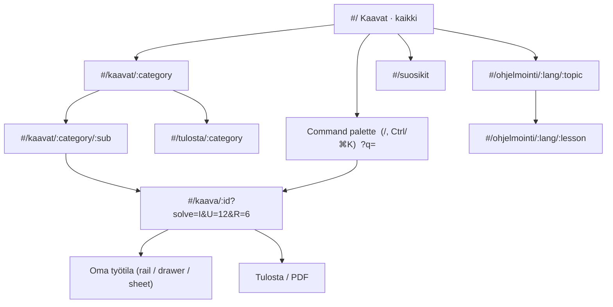
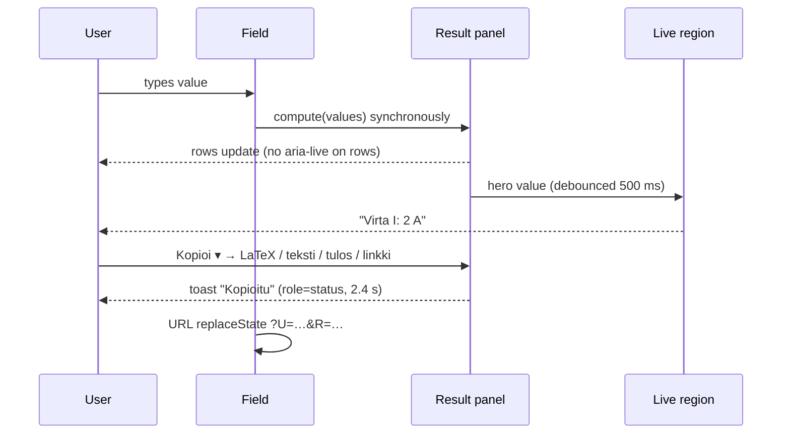

# Kaavasto (inssi-kaavasto): Total Redesign Specification

> **Scope:** a full visual and UX redesign spec for https://villeboee.github.io/inssi-kaavasto/
> **Analysed source:** GitHub `VilleBoee/inssi-kaavasto`, commit `30c9a40` (21 Oct 2026), plus the live build (`docs/assets/index-MsKvH-Xl.js`, `index-r70Q40tY.css`)
> **Audit date:** 16 Nov 2026. Headless Chrome at 1440×900 and 390×844, with an axe-core run, computed-style probes and WCAG contrast math.
> **Reference screenshots (current site):** `/workspace/inssi-redesign/screenshots/`. See Appendix A.
>
> Every number in §1–§2 was measured or read from the source. Everything from §3 on is the proposed design.

---

## Table of contents
1. Current state: what the site is
2. Problems found (evidence-based)
3. Design goals and principles
4. Design tokens (colour, contrast, type, spacing, radii, shadows, z-index, motion, breakpoints)
5. Layout system (shell, wireframes, IA)
6. Components (exact specs and states)
7. Information architecture and UX improvements
8. Accessibility checklist
9. Performance plan
10. Ready-to-paste CSS
11. Example component markup
12. Data-model changes
13. Implementation plan (phased)
14. Appendices

---

## 1. Current state: what the site is

### 1.1 Product
"Kaavasto, Insinöörin kaavakirja" is a Finnish/English engineering formula book. Each formula is also a **live calculator**. The app has two sections plus a workspace:

| Section | Content (counted from source/live DOM) |
|---|---|
| **Kaavasto** (formulas) | **68 formula worksheets** in 6 categories and 24 subcategories: Tietokone 16, Tietoverkot 10, Elektroniikka 9, Fysiikka 20, Matematiikka 7, Suureet 6 |
| **Ohjelmointi** (programming) | **82 code examples** in 6 languages: JavaScript 12, Python 12, C++ 30, Java 10, C 10, SQL 8. Each has topics and a lesson view with plain `<pre>` code (no syntax highlighting) |
| **Oma työtila** (workspace) | A side panel with calculation blocks, notes and formula references, an expression evaluator (`src/lib/expr.ts`, 791 lines) with degree/radian toggle, multiple workspaces, and export/import. Stored in `localStorage` (`kaavasto:workspaces`) |

Other features: favourites (★), "recently used" (last 8), FI/EN toggle, light/dark toggle, deep link to a formula via `#<id>` (e.g. `#ohm`, `#subnet`, `#si`), `/` to focus search, `Esc` to close, "copy result" (plain text), a "Päivitykset" (updates) popover fixed bottom-left, a "Muokattu N pv sitten" build stamp, and "Tyhjennä tallennus" (clear storage).

### 1.2 Tech stack
- React 19 + Vite 8 + Tailwind CSS v4 (`@theme` tokens in `src/styles.css`, 93 lines), `lucide-react` + `react-icons`, `clsx`.
- A single 1,300-line component (`src/components/kaavasto-app.tsx`) holds the shell, header, nav, library, worksheet, footer and update log.
- Built into `/docs` for GitHub Pages. Client-rendered SPA: `<div id="root">` is empty until JS runs.
- **No math renderer.** Formulas are Unicode plain-text strings shown in IBM Plex Mono, e.g. `"P = U·I = I²·R = U²/R"`, `"x = (−b ± √(b² − 4ac)) / 2a"`, `"arvo_uusi = arvo · 10^(exp₁ − exp₂)"`.

### 1.3 Current design tokens (from `src/styles.css`)

| Token | Light | Dark | Use |
|---|---|---|---|
| `--color-bg` | `#e7e2d6` | `#12110e` | page background plus a 24px (1.5rem) grid-paper line pattern |
| `--color-paper` | `#f6f3ec` | `#1c1916` | cards, header |
| `--color-ink` | `#1c1915` | `#f3efe6` | text **and** every filled "active" button **and** the result panel bg |
| `--color-muted` | `#6d675e` | `#b0a89c` | secondary text |
| `--color-line` | `#d5cfc3` | `#3a342c` | all borders, including input borders |
| `--color-accent` | `#b8431f` | `#e07a4c` | eyebrow labels, primary CTA, star |
| `--color-accent-soft` | `#f6e4d8` | `#3d291f` | selected subcategory bg, error text in result |
| `--color-ink-soft` | `#c9c3b6` | `#5e584e` | muted text inside result panel |

Fonts: IBM Plex Sans (400/500/600 + italic 400) and IBM Plex Mono (400/500/600 + italic 400) from Google Fonts. Radii: Tailwind `rounded-md` (6px) and `rounded-lg` (8px). Shadow: `shadow-sm` only. Containers: `max-w-6xl` (1152px), or `max-w-screen-2xl` (1536px) when the workspace is open. Sidebar: 240px (`w-60`). Breakpoints: Tailwind defaults (`sm` 640, `lg` 1024) plus JS `matchMedia` at 1024/1280px. Control heights: 44px (`h-11`) desktop, 36px (`h-9`) and 32px (`h-8`) on mobile.

### 1.4 Measured layout facts

| Measure | Desktop 1440×900 | Mobile 390×844 |
|---|---|---|
| Sticky header height | **199px** (22% of viewport) | **191px** (**23%** of viewport) |
| Home page document height | 7,401px | **11,998px** (68 cards in one column) |
| Formula card | `p-4 pr-14`, title 18px/600, expression 14px mono, blurb 14px | same |
| Detail-page formula | **14px mono** string in a bordered box, the same size as body copy | same |
| Horizontal overflow | none | none |
| Font faces loaded on first view | 8 (Plex Sans 400/500/600, Plex Mono 400; duplicated unicode ranges) | same |
| JS bundle | **605 KB** raw / **193 KB** gzip, one chunk | same |
| CSS | 30.6 KB raw / 6.8 KB gzip | same |

---

## 2. Problems found (evidence-based)

### 2.1 Visual and hierarchy
1. **The formula is not the hero.** On the detail page (`#ohm`, `#si`), the formula is a 14px monospaced string in a thin box. It carries the same weight as the description and less than the "Lisää omaan työtilaan" button under it. A formula book should lead with typeset math.
2. **Plain-text math is ambiguous and inconsistent.** It mixes Unicode sub/superscripts (`I²`, `m₀`), ASCII caret (`10^(exp₁ − exp₂)`), underscores (`t_osuma`, `R_sarja`) and words (`sin α = vastainen / hypotenuusa`). Fractions are inline slashes, which is hard to parse in `δz/z = √((δa/a)² + (δb/b)²)`. Multi-equation lines are joined with three spaces (`F = ma,   G = mg`).
3. **Monochrome "ink" overload.** The same `#1c1915` fill marks the active section tab, the active sidebar item, the active FI/EN and theme toggles, the workspace toggle, the "Lisää työtila" button, the active workspace tab and the result panel. Six or seven black slabs compete on one screen (`desktop-1440-workspace-light.png`), so "active" has no hierarchy.
4. **The grid-paper background** (24px lines at 75% of `--color-line`) is behind everything. It adds noise, lowers the perceived contrast of the already-dark `#e7e2d6` page, and is the main source of "character".
5. **Dark mode inverts the result panel to a light slab.** `bg-ink` becomes `#f3efe6` in dark mode, so the brightest thing on a dark page is the result box (`mobile-390-formula-subnet-dark.png`).
6. **Chrome over content.** The header packs the brand, build stamp, "68 kaavaa", "Oma työtila", "Tyhjennä tallennus" (a destructive action given header prominence), FI/EN and theme segmented controls, a full-width two-button section switch and full-width search. That is three rows and 199px.
7. **Typographic noise.** There are three `text-[10px]` uppercase mono labels with `tracking-widest`. 10px is below comfortable reading size. Group headings ("Tietokone • Lukujärjestelmät") are 14px/500, weaker than the 18px card titles beneath them, so the hierarchy is inverted.

### 2.2 UX and IA
8. **Filters and search are not in the URL.** Only the formula id is (`#ohm`). Category, subcategory and query (`filter`, `subFilter`, `query` in React state) are lost on reload and cannot be shared.
9. **Typing in search closes the open formula** (`if (activeId) closeFormula()`).
10. **No variable legend.** Symbols (`τ`, `μ`, `vₑ`, `k`) are explained only indirectly through input labels. Formulas have no symbol/meaning/unit metadata.
11. **Copy is plain text only.** `copyResult` joins name, expression and result rows with `\n`. There is no LaTeX, no "copy link", and no copy without a computed result.
12. **The mobile library is ~12,000px long** with no in-page jump between the 24 subgroups. The category menu is a drawer behind a "☰ Kaikki" button placed *below* the 191px header.
13. **"Recently used"** appears only when the query is empty and the filter is Kaikki. There is no way to clear it.
14. **The workspace toggle changes what a card click does.** With the workspace open, clicking a card *adds the formula to the workspace* instead of opening it (`onOpen={(id) => (wsOpen ? addFormulaToWorkspace(id) : openFormula(id))}`).
15. **Navigation uses `history.replaceState` everywhere,** so the browser Back button leaves the site instead of returning from a formula to the list.
16. **No print stylesheet** (no `@media print` anywhere), although printing a kaavakirja is an obvious use.

### 2.3 Accessibility (measured)
17. **Text inputs have no visible focus indicator.** The shared control class contains `outline-none`, and the codebase has zero `focus:` utilities. The probe confirms `outline-style: none` and an unchanged border `#d5cfc3` when the search box or a calculator field is focused. This fails WCAG 2.4.7.
18. **Input borders fail non-text contrast.** `#d5cfc3` on `#f6f3ec` is **1.40:1** and on `#e7e2d6` is **1.20:1**. Dark `#3a342c` on `#1c1916` is 1.42:1. The requirement is 3:1 (WCAG 1.4.11).
19. **Text contrast failures.** axe flags the inactive "EN" toggle (`#6d675e` on `#e7e2d6`) at **4.33:1**. Computed: accent eyebrow `#b8431f` on `#e7e2d6` is 4.21:1, and accent on `#f6e4d8` is 4.41:1. Both are below 4.5 for small text.
20. **The H1 contains the build stamp.** The accessible name of `<h1>` is "KaavastoMuokattu 26 pv sitten".
21. **Card titles are `<span>`s inside one big `<button>`.** Heading navigation skips all 68 formulas, and each card's accessible name is title + expression + blurb concatenated.
22. **Fake tabs.** `role="tablist"`/`role="tab"` are used for Kaavasto/Ohjelmointi without `role="tabpanel"`, `aria-controls` or arrow-key support.
23. **The confirmation dialog** ("Haluatko poistaa tallennetut tiedot?") does not move focus into itself (focus stays on the trigger), does not close on `Esc` (verified), and has no focus trap.
24. **`aria-live="polite"` wraps the whole result section,** buttons included, so every keystroke re-announces all rows.
25. **Small touch targets.** Mobile FI/EN and theme buttons are 32×32px (`h-8`/`size-8`). The update-log close button is 28px (`size-7`).
26. **Ignores `prefers-color-scheme`.** Under an emulated dark OS, the page renders light (`body bg = rgb(231,226,214)`). The stored theme is applied only after the bundle executes, which risks a light flash for dark users.

### 2.4 Robustness and performance
27. **`clearStorage()` calls `localStorage.clear()`.** On `villeboee.github.io`, localStorage is shared by **every** GitHub Pages project of that account, so "Tyhjennä tallennus" also wipes other apps' data. Only `kaavasto:*` keys should be removed.
28. **One 193 KB-gzip JS chunk.** It includes all 82 programming lessons (~160 KB of source in `src/lib/code`), the workspace evaluator and both icon libraries, even for a visitor who opens one formula.
29. **Client-only rendering.** Nothing is visible without JS, and every URL has the same `<title>Kaavasto</title>`, which is poor for search and link previews.
30. **Render-blocking cross-origin Google Fonts CSS** for 2 families × 4 styles.

---

## 3. Design goals and principles

| # | Goal | Measurable target |
|---|---|---|
| G1 | **Formula first.** Typeset math is the clearest element on every formula surface | Display formula 22px (mobile) / 26px (≥768) on detail, 17px on cards. Rendered with KaTeX |
| G2 | **Find in < 3 s.** Search and filters reach any of the 68 formulas without scrolling | Command palette (`/`, `Ctrl/⌘K`). Results update < 50 ms. Filters live in the URL |
| G3 | **Calm, technical, trustworthy** | One accent hue for interaction. Neutrals carry the rest. No full-page texture |
| G4 | **Accessible by default** | WCAG 2.2 AA: 0 axe violations, visible focus everywhere, 44×44 touch targets |
| G5 | **Fast on a phone** | Initial JS ≤ 90 KB gz. LCP < 1.8 s (Lighthouse mobile). CLS < 0.02 |
| G6 | **Shareable state** | Every view (category, subcategory, query, formula, input values) is a URL |
| G7 | **Print-ready** | Any formula, or a whole category, prints as a clean A4 cheat sheet |

**Principles**
1. *Hierarchy through size and space, not black fills.* "Active" = tint + 2–3px indicator, never an inverted slab.
2. *One blue for action, one amber "highlighter" for math.* Never both on the same element.
3. *Every number aligns.* Tabular numerals wherever values appear. Results right-aligned.
4. *Progressive disclosure.* Card → detail → workspace. Tables, notes and derivations collapse.
5. *Bilingual parity.* Layouts are tested with the longer Finnish strings ("Ensimmäinen käytettävä", "Lisää omaan työtilaan").

**Visual direction: "Blueprint Paper".** A near-white, very slightly warm page, crisp white surfaces, ink-blue interaction colour, and an amber band behind formulas, like a highlighter in a printed kaavakirja. Dark mode is a cool graphite with the same logic. The ƒ monogram stays, and the burnt-orange brand colour survives as `--accent` (logo, favourites, eyebrows) for continuity.

---

## 4. Design tokens

All sizes are in `rem` against a 16px root, with px in parentheses.

### 4.1 Colour: light theme

| Token | Hex | Role |
|---|---|---|
| `--bg` | `#F7F7F5` | page background |
| `--surface` | `#FFFFFF` | cards, header, panels, inputs |
| `--surface-2` | `#F0F0EC` | hover rows, segmented-control track, table header |
| `--surface-sunken` | `#EBEBE6` | inline code bg, skeletons, pressed |
| `--text` | `#15171C` | primary text, headings |
| `--text-2` | `#40444D` | secondary body, descriptions |
| `--text-3` | `#62666F` | meta, captions, placeholders, counts |
| `--border` | `#DCDCD6` | decorative dividers, card outline |
| `--border-strong` | `#8A8D94` | **input / control boundaries** (≥ 3:1) |
| `--primary` | `#1D4ED8` | links, primary buttons, active indicators |
| `--primary-hover` | `#1A43BC` | primary hover |
| `--primary-active` | `#163A9F` | primary pressed |
| `--on-primary` | `#FFFFFF` | text on primary |
| `--primary-soft` | `#E8EEFC` | selected nav item, chips |
| `--accent` | `#B4410F` | brand burnt-orange: logo, star "on", eyebrows |
| `--formula-bg` | `#FFF8EC` | highlighter band behind math |
| `--formula-rule` | `#E9B25A` | 3–4px left rule of the formula band |
| `--success` / `--success-bg` | `#15803D` / `#EAF6EE` | valid, "copied" |
| `--warning` / `--warning-bg` | `#A15C07` / `#FDF3E3` | approximations, "check the source" notes |
| `--error` / `--error-bg` | `#C2261B` / `#FDECEA` | invalid input, compute errors |
| `--info` / `--info-bg` | `#0E6E9E` / `#E6F3FA` | tips, notes |
| `--result-bg` | `#15171C` | result panel (stays dark in light theme) |
| `--result-text` | `#F4F4F2` | result values |
| `--result-muted` | `#B4B7BE` | result labels and units |
| `--focus-ring` | `#1D4ED8` | 2px outline, 2px offset |
| `--overlay` | `rgb(21 23 28 / .48)` | modal/drawer scrim |
| `--code-bg` / `--code-text` | `#0F1115` / `#E6E8EB` | code blocks (dark in both themes) |

### 4.2 Colour: dark theme

| Token | Hex | | Token | Hex |
|---|---|---|---|---|
| `--bg` | `#0F1115` | | `--accent` | `#F29560` |
| `--surface` | `#171A20` | | `--formula-bg` | `#1D1A14` |
| `--surface-2` | `#1E222A` | | `--formula-rule` | `#B98535` |
| `--surface-sunken` | `#0B0D10` | | `--success` / bg | `#4ADE80` / `#10261A` |
| `--text` | `#ECEDEF` | | `--warning` / bg | `#FBBF24` / `#2A2110` |
| `--text-2` | `#C2C5CC` | | `--error` / bg | `#F87171` / `#2D1414` |
| `--text-3` | `#9A9EA7` | | `--info` / bg | `#5BC0EB` / `#0F2230` |
| `--border` | `#2C313A` | | `--result-bg` | `#0B0D10` (darker than surface; **not inverted**) |
| `--border-strong` | `#6B717C` | | `--result-text` | `#ECEDEF` |
| `--primary` | `#7EA2FF` | | `--result-muted` | `#A3A7AF` |
| `--primary-hover` | `#9AB6FF` | | `--focus-ring` | `#9AB6FF` |
| `--primary-active` | `#B5CAFF` | | `--overlay` | `rgb(0 0 0 / .64)` |
| `--on-primary` | `#0B1020` | | `--code-bg` | `#0B0D10` |
| `--primary-soft` | `#1B2540` | | | |

### 4.3 Contrast ratios (WCAG 2.x relative luminance, computed by `contrast.py`)

**Light**

| Foreground | Background | Ratio | Result |
|---|---|---|---|
| text `#15171C` | bg `#F7F7F5` | 16.72 | AAA |
| text | surface `#FFFFFF` | 17.93 | AAA |
| text-2 `#40444D` | surface | 9.76 | AAA |
| text-3 `#62666F` | surface | 5.75 | AA |
| text-3 | bg | 5.36 | AA |
| text-3 | surface-2 `#F0F0EC` | 5.04 | AA |
| primary `#1D4ED8` | surface | 6.70 | AA |
| primary | bg | 6.25 | AA |
| on-primary `#FFFFFF` | primary | 6.70 | AA |
| on-primary | primary-hover `#1A43BC` | 8.16 | AAA |
| primary | primary-soft `#E8EEFC` | 5.77 | AA |
| accent `#B4410F` | surface | 5.67 | AA |
| accent | formula-bg `#FFF8EC` | 5.37 | AA |
| text | formula-bg | 16.98 | AAA |
| success `#15803D` | surface / success-bg | 5.02 / 4.52 | AA |
| warning `#A15C07` | surface / warning-bg | 5.19 / 4.72 | AA |
| error `#C2261B` | surface / error-bg | 5.85 / 5.12 | AA |
| info `#0E6E9E` | surface / info-bg | 5.61 / 4.96 | AA |
| result-text `#F4F4F2` | result-bg `#15171C` | 16.28 | AAA |
| result-muted `#B4B7BE` | result-bg | 8.93 | AAA |
| border-strong `#8A8D94` | surface | 3.32 | ✓ non-text ≥ 3 |
| focus-ring | bg | 6.25 | ✓ non-text |
| border `#DCDCD6` | surface | 1.38 | decorative only; never the sole boundary of a control |

**Dark**

| Foreground | Background | Ratio | Result |
|---|---|---|---|
| text `#ECEDEF` | bg `#0F1115` | 16.13 | AAA |
| text | surface `#171A20` | 14.88 | AAA |
| text-2 `#C2C5CC` | surface | 10.08 | AAA |
| text-3 `#9A9EA7` | surface / bg / surface-2 | 6.49 / 7.04 / 5.94 | AA |
| primary `#7EA2FF` | surface | 7.05 | AAA |
| on-primary `#0B1020` | primary | 7.66 | AAA |
| primary | primary-soft `#1B2540` | 6.14 | AA |
| accent `#F29560` | surface | 7.67 | AAA |
| text | formula-bg `#1D1A14` | 14.81 | AAA |
| success `#4ADE80` | success-bg | 9.17 | AAA |
| warning `#FBBF24` | warning-bg | 9.51 | AAA |
| error `#F87171` | error-bg / surface | 6.21 / 6.30 | AA |
| info `#5BC0EB` | info-bg | 7.88 | AAA |
| result-text | result-bg `#0B0D10` | 16.61 | AAA |
| result-muted `#A3A7AF` | result-bg | 8.06 | AAA |
| border-strong `#6B717C` | surface | 3.55 | ✓ non-text |
| focus-ring `#9AB6FF` | surface | 8.72 | ✓ non-text |

*Current values for comparison:* muted on bg 4.33 ✗, accent on bg 4.21 ✗, accent on accent-soft 4.41 ✗, input border on paper 1.40 ✗, on bg 1.20 ✗.

### 4.4 Category colours
Used for icons, the 3px card-top stripe and overline text, never as large fills.

| Category | Light | Dark | Lucide icon (kept) |
|---|---|---|---|
| Tietokone | `#4F46E5` | `#A5B4FC` | `Cpu` |
| Tietoverkot | `#0E7490` | `#67E8F9` | `Network` |
| Elektroniikka | `#B45309` | `#FCD34D` | `Zap` |
| Fysiikka | `#7C3AED` | `#C4B5FD` | `Atom` |
| Matematiikka | `#BE185D` | `#F9A8D4` | `Sigma` |
| Suureet | `#047857` | `#6EE7B7` | `Ruler` |

All light values are ≥ 4.5:1 on `#FFFFFF` and all dark values are ≥ 7:1 on `#171A20`, so 12px overline text in these colours is compliant.

### 4.5 Typography

**Families** (self-hosted WOFF2, latin + latin-ext subsets for ä/ö/å, Greek for µ/Ω/τ)

```css
--font-sans: "Inter var", "Inter", ui-sans-serif, system-ui, -apple-system, "Segoe UI", Roboto, "Helvetica Neue", Arial, sans-serif;
--font-mono: "JetBrains Mono", ui-monospace, "SF Mono", "Cascadia Mono", Menlo, Consolas, monospace;
--font-math: "KaTeX_Main", "Latin Modern Math", "STIX Two Math", "Cambria Math", serif;
```

- **Inter** (variable, one file ≈ 95 KB) replaces 6 Plex Sans faces. Use `font-feature-settings: "cv11", "ss01"`, and turn on `tnum` only on numeric elements.
- **JetBrains Mono** 400/600 for code, units and result values. It clearly separates `0/O` and `1/l/I`, which matters for IP addresses, hex and binary strings (Tietokone/Tietoverkot calculators).
- **Math: KaTeX**, rendered at build time (§9). Its own `KaTeX_Main`/`KaTeX_Math`/`KaTeX_Size1–4` fonts are used only inside `.katex`. *Alternative if bundle size must be zero:* native MathML Core with `font-family: "Latin Modern Math", "STIX Two Math", math` (works in Chrome 109+, Firefox, Safari), but rendering is less uniform.
- `font-display: swap`. Preload Inter only.

**Type scale** (ratio ~1.2–1.25, line-heights on a 4px grid)

| Token | Size | Line-height | Weight | Letter-spacing | Use |
|---|---|---|---|---|---|
| `--fs-display` | 2.25rem (36px) | 2.75rem (44px) | 650 | −0.02em | Detail H1 (≥768) |
| `--fs-h1` | 1.875rem (30px) | 2.25rem (36px) | 650 | −0.015em | Detail H1 (mobile), page titles |
| `--fs-h2` | 1.5rem (24px) | 2rem (32px) | 600 | −0.01em | Category heading |
| `--fs-h3` | 1.25rem (20px) | 1.75rem (28px) | 600 | −0.005em | Subcategory heading, section titles |
| `--fs-lg` | 1.125rem (18px) | 1.75rem (28px) | 400 | 0 | Lead / blurb on detail |
| `--fs-card-title` | 1.0625rem (17px) | 1.5rem (24px) | 600 | −0.005em | Card titles |
| `--fs-base` | 1rem (16px) | 1.5rem (24px) | 400 | 0 | Body, **all inputs** (≥ 16px prevents iOS zoom) |
| `--fs-sm` | 0.875rem (14px) | 1.25rem (20px) | 400/500 | 0 | Secondary text, labels, buttons |
| `--fs-xs` | 0.75rem (12px) | 1rem (16px) | 600 | 0.06em (uppercase only) | Overlines, counts, kbd |
| `--fs-math-display` | 1.375rem (22px) → 1.625rem (26px) at ≥768 | 1.4 | — | — | KaTeX display on detail |
| `--fs-math-card` | 1.0625rem (17px) | 1.5 | — | — | KaTeX inline on cards |
| `--fs-result-hero` | 1.75rem (28px) | 2.25rem (36px) | 600 mono | −0.01em | Emphasised result value |

Rules: **minimum 12px anywhere** (this retires all `text-[10px]`). Body measure max **68ch**. Uppercase only for `--fs-xs` overlines. `text-wrap: balance` on headings (kept) and `pretty` on paragraphs (kept).

### 4.6 Spacing scale (4px base)

| Token | 0.5 | 1 | 2 | 3 | 4 | 5 | 6 | 8 | 10 | 12 | 16 | 20 |
|---|---|---|---|---|---|---|---|---|---|---|---|---|
| px | 2 | 4 | 8 | 12 | 16 | 20 | 24 | 32 | 40 | 48 | 64 | 80 |
| rem | .125 | .25 | .5 | .75 | 1 | 1.25 | 1.5 | 2 | 2.5 | 3 | 4 | 5 |

**Rhythm:** cards gap 16 (12 below 640px). Card padding 20 (16 below 640). Subcategory groups 40 apart. Categories 64 apart. Label → control 6. Control → hint 6. Field → field 20 vertical / 16 horizontal. Detail sections 40 apart. Page top padding 32 (24 mobile). Page bottom 80 (plus the bottom bar on mobile).

### 4.7 Radii
`--radius-xs` 4px (kbd, inline code, `<mark>`) · `--radius-sm` 6px (inputs, buttons, nav items, formula band on cards) · `--radius-md` 10px (cards, detail formula band, tables, callouts, toasts) · `--radius-lg` 14px (result panel, dialogs, palette) · `--radius-xl` 20px (mobile bottom-sheet top corners) · `--radius-full` (chips, badges).

### 4.8 Elevation

| Token | Light | Dark | Use |
|---|---|---|---|
| `--shadow-1` | `0 1px 2px rgb(16 18 24/.06), 0 1px 1px rgb(16 18 24/.04)` | `0 1px 2px rgb(0 0 0/.5)` | cards at rest |
| `--shadow-2` | `0 4px 12px -2px rgb(16 18 24/.10), 0 2px 4px rgb(16 18 24/.06)` | `0 4px 12px rgb(0 0 0/.55)` | card hover, header after scroll |
| `--shadow-3` | `0 12px 32px -8px rgb(16 18 24/.18), 0 4px 8px rgb(16 18 24/.06)` | `0 12px 32px rgb(0 0 0/.6)` | menus, popovers, palette |
| `--shadow-4` | `0 24px 64px -12px rgb(16 18 24/.28)` | `0 24px 64px rgb(0 0 0/.7)` | dialogs, drawers, sheets |

In dark mode, elevation is also conveyed by surface lightness (`surface` → `surface-2`).

### 4.9 Z-index
`--z-sticky` 20 (table heads, chip rail) · `--z-header` 30 · `--z-sidebar` 35 · `--z-overlay` 40 · `--z-drawer` 50 (nav drawer, workspace sheet, bottom bar) · `--z-popover` 60 (menus, tooltips) · `--z-modal` 70 (dialogs, palette) · `--z-toast` 80 · skip link 90.

### 4.10 Motion

| Token | Value | Use |
|---|---|---|
| `--dur-instant` | 80ms | press feedback |
| `--dur-fast` | 140ms | hover colour, focus ring, card lift |
| `--dur-base` | 200ms | popovers, accordions, header hide/show |
| `--dur-slow` | 280ms | drawers, sheets, dialogs |
| `--ease-standard` | `cubic-bezier(.2,0,0,1)` | default |
| `--ease-enter` | `cubic-bezier(0,0,.2,1)` | entering elements |
| `--ease-exit` | `cubic-bezier(.4,0,1,1)` | leaving elements |

Animate only `opacity`, `transform`, `background-color`, `border-color`, `color` and `box-shadow`. Under `prefers-reduced-motion: reduce`, drawers and dialogs fade only (no translate) with durations ≤ 80ms. Keep the existing global reduced-motion rule. "Kopioitu" feedback lasts 1600ms (current value, kept) and toasts 2400ms.

### 4.11 Breakpoints, grid and containers

| Name | Min width | Columns | Gutter | Side padding (`--page-pad`) | Layout |
|---|---|---|---|---|---|
| xs | 0 | 4 | 12 | 16 | single column, top chip rail, bottom bar, workspace = bottom sheet |
| sm | 640 | 8 | 16 | 24 | 2-col cards |
| md | 768 | 8 | 16 | 32 | 2-col cards, larger math |
| lg | 1024 | 12 | 24 | 32 | docked sidebar 248 + content, workspace = right drawer 420 |
| xl | 1280 | 12 | 24 | 40 | sidebar + content + optional right rail 400 (workspace) / TOC 220 on detail |
| 2xl | 1536 | 12 | 32 | 48 | shell max 1440, centred |

Containers: `--container-max` 1440px · `--content-max` 1040px · `--reading-max` 760px (detail) · `--sidebar-w` 248px · `--rail-w` 400px · `--header-h` 64px (≥1024) / 56px.

Card grid: `repeat(auto-fill, minmax(min(100%, 18.5rem), 1fr))`, which gives 1 column at 390, 2 at 640–1279 (with sidebar), and 3 at ≥1280 without the workspace rail.

---

## 5. Layout system

### 5.1 Desktop shell (≥1024)

```
┌────────────────────────────────────────────────────────────────────────────────────┐
│ HEADER 64  [ƒ Kaavasto]  Kaavat  Ohjelmointi     [🔍 Hae kaavoja…        / ]  ☆ FI ◐ ⋯ │
├─────────────┬──────────────────────────────────────────────────┬───────────────────┤
│ SIDEBAR 248 │ CONTENT (max 1040)                                │ RAIL 400 (opt.)   │
│ sticky      │ Kaavat › Fysiikka                     14px        │ Oma työtila       │
│ top: 88     │ ┌ toolbar 48: 20 / 68 · [suodata…] · Lajittele · ▦≡ ┐│                   │
│             │ ■ Fysiikka  20 kaavaa                  H2 24/32   │                   │
│ Kaikki   68 │ ───────────────────────────────────────────────── │                   │
│ ☆ Suosikit 3│ Newton                                 H3 20/28   │                   │
│ ─────────── │ ┌────────┐ ┌────────┐ ┌────────┐   gap 16          │                   │
│ ▸ Tietokone │ │ card   │ │ card   │ │ card   │                   │                   │
│ ▸ Verkot    │ └────────┘ └────────┘ └────────┘                   │                   │
│ ▾ Fysiikka  │                                     ↕ 40           │                   │
│ │ Newton    │ Työ ja energia                                     │                   │
│ │ Vektorit  │ ┌────────┐ ┌────────┐                              │                   │
│ ─────────── │                                                    │                   │
│ Viimeksi    │                                                    │                   │
├─────────────┴──────────────────────────────────────────────────┴───────────────────┤
│ FOOTER                                                                              │
└────────────────────────────────────────────────────────────────────────────────────┘
```

Shell grid: `grid-template-columns: var(--sidebar-w) minmax(0,1fr) [var(--rail-w)]`, `column-gap: 32px`, inline padding `--page-pad`, content padding-top 32, bottom 80.

### 5.2 Mobile shell (390)

```
┌──────────────────────────────┐
│ HEADER 56  ƒ Kaavasto   🔍  ⋯ │  hides on scroll-down, shows on scroll-up
├──────────────────────────────┤
│ CHIP RAIL 48 ← scroll →       │  Kaikki · ☆ · Tietokone · Verkot · Elektr…
├──────────────────────────────┤
│ Lukujärjestelmät          3   │  H3 20/28
│ ┌──────────────────────────┐ │
│ │ card  (P 16)              │ │  gap 12
│ └──────────────────────────┘ │
│              …                │
├──────────────────────────────┤
│ BOTTOM BAR 64 + safe-area     │  Kaavat · Haku · Suosikit · Työtila
└──────────────────────────────┘
```

Sticky chrome is **104px top (56 + 48) + 64px bottom**, against 191px top today. The bottom bar is always reachable by thumb.

### 5.3 Formula detail page

```
 Kaavat › Elektroniikka › Piirit                               breadcrumb 14px text-3
 ELEKTRONIIKKA · PIIRIT                                        overline 12/600 cat colour
 Ohmin laki                                                    H1 36/44 (30/36 mobile)
 Ratkaise jännite, virta tai resistanssi, kun kaksi muuta…     lead 18/28 text-2, max 62ch
 [☆ Suosikki] [⧉ Kopioi ▾] [+ Työtilaan] [🖨 Tulosta]          40px buttons, gap 8, mt 20
 ┌─────────────────────────────────────────────────────────┐
 ▌                     U = I · R                             │  FORMULA BAND  P 24/32, 26px
 └─────────────────────────────────────────────────[⧉]─────┘   (copy LaTeX)
 Symbolit                                                       H2 20/28, mt 40
 ┌───────┬──────────────────────┬───────────┐
 │ U     │ jännite              │ V         │  rows 40
 │ I     │ virta                │ A         │
 │ R     │ resistanssi          │ Ω         │
 └───────┴──────────────────────┴───────────┘
 ┌ Laskuri ─────────────────────┐ ┌ TULOS ───────[Kopioi][Tallenna]┐ ≥1024: 2 cols, gap 24
 │ Ratkaistaan [Virta I      ▾] │ │ Virta I                        │ result sticky top 88
 │ Jännite U   [12          V ] │ │ 2 A               (28px mono)  │
 │ Resistanssi [6           Ω ] │ │ Jännite U               12 V   │
 │ ↺ Palauta esimerkki          │ │ Resistanssi              6 Ω   │
 └──────────────────────────────┘ │ Teho P = U·I            24 W   │
                                  └────────────────────────────────┘
 ⓘ Huomio …                                                    callout
 ▸ Taulukko: …                                                 <details>
 Liittyvät: Sähköteho · Jännitteenjako · Sarjaankytkentä       compact cards
 [‹ Edellinen: …]                          [Seuraava: … ›]     64px link boxes
```

**Mobile:** the result panel sits directly below the inputs. When the user scrolls past it, a sticky **result peek** (H 56, `bottom: calc(64px + env(safe-area-inset-bottom))`, `--result-bg`, radius 14 14 0 0) shows the emphasised value ("Virta I = 2 A ⌃"). Tapping it scrolls back to the full panel.

### 5.4 Information architecture



---

## 6. Components (exact specs)

Conventions: H = height, P = padding (block / inline), G = gap. Hit areas are ≥ 44×44 under `(pointer: coarse)`. On fine pointers the default control height is 40px.

### 6.1 Header
- **Size:** H 64 (≥1024) / 56. P 0 / `--page-pad`. Background `color-mix(in oklab, var(--surface) 88%, transparent)` + `backdrop-filter: saturate(1.4) blur(10px)`, border-bottom 1px `--border`. Gets `--shadow-2` when `scrollY > 4`. On mobile it hides on scroll-down (translateY(−100%), `--dur-base`).
- **Brand:** 32×32 tile (radius 8, bg `--text`, glyph "ƒ" italic 20px `--font-math` in `--surface`) + "Kaavasto" 18px/650, −0.01em, G 10. *The build stamp leaves the H1* and moves to the footer as an absolute date "Päivitetty 21.10.2026".
- **Section switch** (≥1024): two **links** "Kaavat" / "Ohjelmointi" with `aria-current="page"`. H 40, P 0/14, 14px/500, `--text-3`, hover `--text`. Active: `--text` + 2px `--primary` underline flush with the header bottom. Below 1024 they move to the bottom bar.
- **Search trigger:** W 360 (lg) / 440 (xl), H 40, P 0/12, radius 6, 1px `--border-strong`, bg `--surface`. Contents: 18px search icon `--text-3`, "Hae kaavoja…" 14px `--text-3`, `kbd "/"` (20×20, 12px mono, `--surface-2`, radius 4) right-aligned. Hover border `--text-3`. Below 1024 it is a 44×44 icon button.
- **Right cluster** (G 4, all 40×40 icon buttons, ghost): Favourites (badge 16px circle `--primary` / `--on-primary` 11px/600 at top-right), language "FI" (opens a 2-item menu with check marks), theme (cycles System → Light → Dark, icon Monitor/Sun/Moon, `aria-label="Teema: järjestelmä"`), overflow "⋯" menu: *Päivitykset*, *Tulosta*, *Pikanäppäimet*, divider, *Tyhjennä tallennetut tiedot…* (`--error` text, opens the dialog in 6.14).
- **Removed from the header:** formula count (now in the sidebar and toolbar) and the "Tyhjennä tallennus" button.

### 6.2 Sidebar (≥1024)
- W 248. `position: sticky; top: calc(var(--header-h) + 24px); max-height: calc(100dvh - var(--header-h) - 48px); overflow-y: auto; scrollbar-gutter: stable`.
- Order: Kaikki (68) · Suosikit (n) · divider (1px `--border`, margin 12/0) · 6 categories · divider · "Viimeksi käytetyt" (overline 12px, 5 items at 13px, "Tyhjennä" text link).
- **Item:** `<a>`, H 36 (44 coarse), P 0/10, radius 6, G 10, 14px/500 `--text-2`. Icon 18px in category colour. Count right, 12px mono `--text-3`, tabular.

| State | Style |
|---|---|
| Rest | transparent, `--text-2` |
| Hover | bg `--surface-2`, `--text` |
| Active (`aria-current="page"`) | bg `--primary-soft`, `--primary`, weight 600, `box-shadow: inset 3px 0 0 var(--primary)` |
| Focus-visible | 2px `--focus-ring`, offset 2 |
| Scroll-spy (in view while browsing Kaikki) | `--text`, weight 600, no bg |

- **Subcategories:** a 24×24 chevron button toggles them (`aria-expanded`, rotates 90°, `--dur-base`). Sub-list margin-left 19px, padding-left 9px, 1px `--border` guide line. Sub item H 32 (44 coarse), P 0/8, 13.5px `--text-3`, same active style. Multiple categories can be open at once. Open state persists (`kaavasto:nav-open`).

### 6.3 Mobile navigation (< 1024)
- **Chip rail:** sticky under the header (`top: var(--header-h)`, follows the header when it hides), H 48, P 8/16, `overflow-x: auto`, `scroll-snap-type: x proximity`, 24px edge fade masks, bg `--bg` + 1px bottom `--border`. Chip: H 32 (44 hit via `::before { inset: -6px 0 }`), P 0/12, radius full, 14px/500, 1px `--border-strong`, `--text-2`. Selected: bg `--primary-soft`, border and text `--primary`, plus a 16px check icon. Selecting a category reveals a second rail of sub-chips (H 44) under it.
- **Bottom bar** (< 768; at 768–1023 the section links stay in the header): 4 items (Kaavat, Haku, Suosikit, Työtila), H 64 + `env(safe-area-inset-bottom)`, icon 22px over a 12px/500 label, G 4. Active `--primary` with a 32×4 indicator above the icon. bg `--surface`, 1px top `--border`.
- **Full tree drawer** ("Kaikki aihealueet" link at the end of the chip rail): left side, W `min(320px, 86vw)`, `--surface`, `--shadow-4`, radius 0 14 14 0, translateX enter in 280ms `--ease-enter`. Focus is trapped, returns to the trigger, and `Esc` or the scrim closes it.

### 6.4 Search: command palette
- Opens on `/`, `Ctrl/⌘K`, the header trigger or the bottom bar. A `<dialog>` containing a **combobox**: `input[role=combobox][aria-expanded][aria-controls=palette-list][aria-activedescendant]`, list `role="listbox"`, rows `role="option"`.
- **Desktop:** W 640, max-H `min(560px, 80dvh)`, top 12vh, radius 14, `--surface`, `--shadow-3`, backdrop `--overlay`. **Mobile:** full-screen with the input pinned at the top.
- Input row H 56, P 0/16, 18px text, 20px icon, "Esc" kbd at the right. 1px divider. Scope chips under it (H 28, 13px): *Kaikki · Kaavat · Ohjelmointi · Suosikit*.
- Result groups: overline 12px `--text-3`, P 12/16/4. **Row** H 56, P 0/16, G 12: icon 18px (category colour) · title 15px/500 · KaTeX preview 14px `--text-2` (single line, ellipsis) · "↵" kbd on the active row. Active row: bg `--surface-2` + inset 2px `--primary` left. 8 rows are visible before scrolling. Matches are wrapped in `<mark>` (bg `--formula-bg`, radius 2, `--text`).
- **Ranking:** exact id/name prefix > name word > tag > variable symbol/name > blurb. Keep the current diacritic folding (`normalize("NFD").replace(/\p{M}/gu,"")`) and AND-of-words logic. Index both FI and EN names regardless of UI language.
- **Empty query:** 5 recents + 5 favourites. **No results:** "Ei tuloksia haulle ‘{q}’" + 3 suggestion chips (newton, aliverkko, RAID).
- **Inline filter:** the library toolbar also has a filter input that filters the grid in place and writes `?q=`. It never closes an open formula (fixes #9).

### 6.5 Library headings
- **Category H2:** 24/32/600 `--text`, preceded by a 28×28 icon tile (radius 8, bg `color-mix(in oklab, var(--cat) 12%, transparent)`, icon 16px `--cat`), G 12, then the count "20 kaavaa" 14px `--text-3`. Margin-top 64 (0 for the first), 1px `--border` underneath with 24px space before the first H3.
- **Subcategory H3:** 20/28/600, `id` slug for deep linking, hover reveals a "#" anchor (`--text-3`, 16px) at −20px. Margin 40/0/16. Count after the name: 14px `--text-3`.
- The current combined label "Tietokone • Lukujärjestelmät" is removed, because the hierarchy is now real headings.

### 6.6 Formula card

```
┌▔▔▔▔▔▔▔▔▔▔▔▔▔▔▔▔▔▔▔▔▔▔▔▔▔▔▔▔▔▔▔▔▔▔▔▔▔▔┐  3px stripe, category colour
│ LUKUJÄRJESTELMÄT                    ☆ │  overline 12/16 600 cat colour · star 32 (44 coarse)
│ Kahden komplementti                   │  title 17/24 600  (h4, stretched link)
│ ┃ signed = unsigned − 2ⁿ              │  formula band, KaTeX inline 17px, P 8/12, min-H 40
│ Etumerkillinen kokonaisluku annetulla │  blurb 14/20 text-2, clamp 2 lines
│ bittileveydellä.                      │
└───────────────────────────────────────┘
```

- Box: `--surface`, 1px `--border`, radius 10, `--shadow-1`, P 20 (16 below 640), G 10, min-H 176 (auto below 640).
- Semantics: `<article>` → `<h4><a href="#/kaava/:id">` with a stretched `::after` link. The star is a **sibling** `<button aria-pressed>` (no nested interactive elements). Keep the existing labels "Lisää suosikkeihin: {name}" / "Poista suosikeista: {name}".
- Formula band: bg `--formula-bg`, `box-shadow: inset 3px 0 0 var(--formula-rule)`, radius 6, `overflow-x: auto` (never wraps mid-expression), 12px right fade when overflowing.

| State | Style |
|---|---|
| Hover (hover-capable) | border `--border-strong`, `--shadow-2`, translateY(−1px), title `--primary`, 140ms |
| Focus-visible | `.f-card:has(a:focus-visible)` → 2px `--focus-ring` outline, offset 2 |
| Active | translateY(0), `--shadow-1` |
| Favourite | filled `--accent` star + 6px `--accent` dot after the overline |
| Workspace open | an extra 32×32 "+" button (left of the star) adds the card to the workspace. Clicking the card still opens it (fixes #14) |

- **Compact/list variant** (toolbar toggle): row H 56, P 0/16, title 15px/500 left, inline formula 14px right (max 50%), 1px `--border` separators in one bordered container (radius 10).

### 6.7 Library toolbar
H 48, margin-bottom 24, G 12: live count "20 / 68 kaavaa" (14px `--text-3`, tabular; the only `aria-live="polite"` in the list view) · filter input (W 280, H 40, search icon) · sort menu (Aihe, A–Ö, Viimeksi käytetty) · grid/list `radiogroup` (2 × 32px). Active filters show as removable chips below (H 28, radius full, `--primary-soft`/`--primary`, "×" 16px) + "Tyhjennä suodattimet" text button. Below 640 the filter is full-width and sort/view collapse into a 40×40 menu.

### 6.8 Formula detail
- Container max 760, padding-top 24, section gap 40. At ≥1280 a 220px "Tällä sivulla" TOC sits to the right (sticky, 13px links: Kaava, Symbolit, Laskuri, Taulukot, Huomiot).
- **Breadcrumb:** 14/20 `--text-3`, "›" separators with 8px margins, current item `--text-2` and `aria-current="page"`.
- **Header block:** overline (12/600 uppercase .06em `--cat`) → H1 (36/44, or 30/36 below 768, −0.02em) → lead (18/28 `--text-2`, max 62ch, margin-top 8) → action row (margin-top 20, G 8): secondary buttons H 40 with 16px icons: ☆ *Suosikki* (toggle, `aria-pressed`), ⧉ *Kopioi* ▾ (menu: LaTeX, Teksti, Tulos, Linkki tuloksineen), + *Työtilaan*, 🖨 *Tulosta*. Below 640 this becomes 3 icon buttons + "⋯".
- **Formula band (display):** radius 10, P 24/32 (20/16 below 768), bg `--formula-bg`, `inset 4px 0 0 var(--formula-rule)`, KaTeX `displayMode`, font-size `--fs-math-display`, centred, `overflow-x: auto`. Multi-equation formulas use `\begin{gathered}` (one equation per line, 12px row gap). The copy-LaTeX icon (32×32) is at top-right 8/8 and shows a "Kopioitu" tooltip for 1600ms.
- **Symbol legend:** see 6.11 (`.f-legend`). Columns Symboli (64px, KaTeX 16px) | Merkitys | Yksikkö (mono 14px). Rows H 40.
- **Calculator:** H2 "Laskuri" 20/28. Field grid `repeat(auto-fit, minmax(220px, 1fr))`, G 20/16. The "Ratkaistaan" select spans the full width. "↺ Palauta esimerkki" is a tertiary text button (H 40, `--primary`) below the fields.
- **Calculator + result layout:** ≥1024 is a 2-column grid `minmax(0,1fr) minmax(0,1fr)`, G 24, with the result `position: sticky; top: calc(var(--header-h) + 24px)`. Below 1024 it stacks, with the mobile peek from 5.3.
- **Notes:** `formula.note` → info callout. The global disclaimer "Laskurit ovat tarkastus- ja opiskelukäyttöön. Kriittinen mitoitus tarkistetaan alkuperäislähteestä." → warning callout under every calculator (14px, not footer-only).
- **Tables:** in `<details>` ("Taulukko: {title}"), open by default for reference-only formulas.
- **Related:** up to 4 compact cards from the same subcategory. **Prev/next:** two link boxes (H 64, P 12/16, radius 10, 1px `--border`, overline "‹ Edellinen" / "Seuraava ›" 12px + title 15/500).

### 6.9 Form controls

| Property | Value |
|---|---|
| Height | 44px (input, select). Textarea min 112, P 12 |
| Padding | 0 12. With a unit suffix: padding-right 56 (unit ≤ 8 chars stays inline, current rule kept) |
| Font | 16px. Numeric inputs `--font-mono` + `tnum` |
| Background / border / radius | `--surface` / 1px `--border-strong` / 6px |
| Label | 14/20 500 `--text`, margin-bottom 6. Long units as "(bittiä)" 400 `--text-3` |
| Hint | 13/18 `--text-3`, margin-top 6, `aria-describedby` |
| Unit suffix | 14px mono `--text-3`, right 12, `pointer-events: none`, `aria-hidden` (unit is in the label's accessible name) |
| Hover | border `--text-3` |
| Focus | border `--primary` + `0 0 0 3px color-mix(in oklab, var(--primary) 28%, transparent)` |
| Invalid | `aria-invalid="true"`, border `--error`, ring error 24%, message 13px `--error` with a 16px alert icon, linked by `aria-describedby` |
| Disabled | bg `--surface-2`, text `--text-3`, border `--border`, `not-allowed` |
| Select | `appearance: none`, 16px chevron at right 12, padding-right 36 |

Map `compute()` errors (e.g. `"x" ei ole luku.`, `Luku ei mahdu 8 bittiin`) to the offending field when it can be identified, otherwise show them in the result panel.

### 6.10 Result panel
- `--result-bg` / `--result-text`, radius 14, overflow hidden.
- **Head:** min-H 52, P 8/20, 1px `--result-line` bottom. "TULOS" overline 12/600 `--result-muted`. Actions: "Kopioi" (ghost-inverse, 1px `rgb(255 255 255/.2)`, H 36) and "Tallenna työtilaan" (primary, H 36).
- **Hero row** (`emphasis: true`): P 20, label 13px `--result-muted`, value 28/36 600 mono tabular, unit 16px `--result-muted` 6px after it. IPv4 subnet shows "192.168.1.0 /24".
- **Rows:** min-H 44, P 10/20, grid `minmax(0,2fr) minmax(0,3fr)`, G 16, label 14px `--result-muted`, value 15/22 mono right-aligned, `overflow-wrap: anywhere` (IPv6, long binary). 1px `--result-line` separators. A per-row copy icon (24px) appears on hover/focus.
- **Empty:** "Täytä kentät, niin tulos lasketaan." 14px `--result-muted`, P 20. **Error:** 16px icon + message in `--error` (dark value `#F87171` in both themes inside the panel).
- **Announcements:** one visually hidden `<p aria-live="polite">` with only the hero value ("Virta I: 2 A"), debounced 500ms. Remove `aria-live` from the section (fixes #24).

### 6.11 Data tables (reference tables, symbol legend)
- Wrapper: radius 10, 1px `--border`, `overflow-x: auto`, scroll shadows (`background-attachment: local` technique).
- Title row: P 12/16, 14/20 600 `--text` (replaces orange uppercase).
- `th`: bg `--surface-2`, 12/16 600 uppercase .04em `--text-3`, P 10/16, sticky top 0, bottom border 1px `--border-strong`.
- `td`: P 10/16, 14/20. First column 500 `--text`. Numeric columns mono tabular right-aligned. Rows divided by 1px `--border`. Zebra (`--surface-2` 50%) for tables ≥ 8 rows. Hover `color-mix(--primary-soft 60%)`.
- Below 640: horizontal scroll is kept. The first column is `position: sticky; left: 0` on `--surface` with a 1px right border.

### 6.12 Buttons

| Variant | H | P | Font | Rest | Hover | Active | Disabled |
|---|---|---|---|---|---|---|---|
| Primary | 40 (44 coarse) | 0/16 | 14/600 | `--primary` bg, `--on-primary` | `--primary-hover` | `--primary-active`, scale .98 | opacity .4 |
| Secondary | 40 | 0/14 | 14/500 | `--surface`, `--text`, 1px `--border-strong` | `--surface-2` | `--surface-sunken` | `--text-3`, border `--border` |
| Ghost | 40 | 0/12 | 14/500 | transparent, `--text-2` | `--surface-2`, `--text` | `--surface-sunken` | `--text-3` |
| Tertiary (text) | 40 | 0/8 | 14/500 | `--primary` | underline | `--primary-active` | `--text-3` |
| Danger | 40 | 0/16 | 14/600 | `--error` bg, `#FFF` (light) / `#1A0B0B` (dark) | 8% darker | 14% darker | opacity .4 |
| Icon | 40×40 (44 coarse) | — | 18px icon | ghost | ghost | ghost | ghost |
| Small | 32–36 | 0/10–12 | 13/500 | per variant | | | |

All buttons: radius 6, G 8 between icon and label, 140ms colour transitions, focus-visible 2px ring offset 2. Loading state: 16px spinner replaces the icon and the width is preserved.

### 6.13 Callouts
Radius 10, P 12/16, G 12, border 1px `color-mix(in oklab, var(--{type}) 30%, transparent)`, bg `--{type}-bg`, 18px icon in `--{type}` (Info, AlertTriangle, CheckCircle2, XCircle), title 14/20 600 `--text`, body 14/20 `--text-2`.

### 6.14 Dialog ("Tyhjennä tallennetut tiedot")
A native `<dialog>` opened with `showModal()`, which gives a focus trap, `Esc` and an inert background (fixes #23). W `min(440px, 100vw − 32px)`, P 24, radius 14, `--shadow-4`, `::backdrop` `--overlay`. Title 20/28 600. Body 14/20 `--text-2` that lists exactly what is removed: "Suosikit (3), viimeksi käytetyt, kieli, teema ja 2 työtilaa". Actions right-aligned, G 8, margin-top 24: **Peruuta** (secondary, initial focus) · **Poista tiedot** (danger). Animation: opacity 0→1 + scale .98→1, 200ms.

### 6.15 Workspace (Oma työtila)
- ≥1280: right rail 400px, `--surface`, 1px left `--border`, sticky under the header with its own scroll. 1024–1279: right drawer 420px over the content with a scrim. < 1024: bottom sheet (snap points 45% / 92%, top radius 20, 36×4 grab handle `--border-strong`, `--shadow-4`).
- Header H 56, P 0/16: title 16/600 + workspace switcher (menu button "Tehtävä 1 ▾", replacing the black full-width tab) + "Piilota kaavasto" icon toggle + close.
- Blocks: radius 10, 1px `--border`, P 16, G 12. Toolbar icons 32×32 ghost. Expression lines mono 15/22, results right-aligned tabular.
- Actions: "+ Lasku" (primary) and "+ Muistiinpano" (secondary). *Kopioi koko ratkaisu*, *Vie data*, *Tuo data* and Asteet/Radiaanit move into the "⋯" menu, with the angle mode also shown as a 2-segment control (H 32) in the header.
- The persistence note "Työtilat säilyvät tässä selaimessa…" becomes an info callout shown only until it is dismissed.

### 6.16 Programming section
- Same shell. The sidebar lists languages with their existing brand glyphs (converted to inline SVG, §9) and counts.
- Lesson card: overline = filename (`hello.js`) in 12px mono `--text-3` (not orange), title 17/600, blurb 14/20 clamp 3.
- **Code block:** bg `--code-bg` in both themes (keeps "koodi pysyy tummana"), radius 10. Header bar H 36, P 0/12/0/16, 12px mono `rgb(255 255 255/.6)` language label, copy button 28×28. Body P 16/20, 14/22 JetBrains Mono, `tab-size: 2`, `overflow-x: auto`. **Syntax highlighting at build time with Shiki** (theme `github-dark-dimmed`), with no runtime JS.

### 6.17 Footer
1px top `--border`, bg `--surface`, P 32/`--page-pad`/48, container 1440. ≥768: 3 columns (G 24). Mobile: stacked. (1) Brand + disclaimer 14/20 `--text-3`. (2) Links: Päivitykset, Lähdekoodi (GitHub), Tulosta kaavasto. (3) Shortcuts: `/` Haku · `Esc` Sulje · `F` Suosikki · `C` Kopioi LaTeX. Bottom row 12px `--text-3`: "Päivitetty 21.10.2026". The fixed bottom-left "PÄIVITYKSET" pill is removed. Updates open in a dialog listing the existing `UPDATES` items with dates.

### 6.18 Toast
Bottom-centre (`bottom: 24px`, or `calc(80px + env(safe-area-inset-bottom))` above the mobile bottom bar), max-W 420, H 44, P 0/16, radius 10, inverted (`--text` bg / `--surface` text), 14/500, 16px icon, `--shadow-3`, `role="status"`, shown for 2400ms. Used for Kopioitu · Lisätty työtilaan · Lisätty suosikkeihin (with "Kumoa").

### 6.19 Empty states
Centred, P 64/24, 72px circle `--surface-2` with a 32px `--text-3` icon, title 18/26 600, body 14/20 `--text-2` max 40ch, then a primary button. Variants: no results ("Tyhjennä haku"), no favourites ("Merkitse usein käyttämäsi kaavat tähdellä ☆."), empty workspace ("+ Lisää ensimmäinen lasku").

---

## 7. Information architecture and UX improvements

### 7.1 URL scheme (hash routing kept for GitHub Pages)

| View | URL |
|---|---|
| All formulas | `#/` |
| Category / subcategory | `#/kaavat/fysiikka` · `#/kaavat/fysiikka/pyoriminen` (ids = existing `CategoryId` / `SUBCATEGORIES[].id`) |
| Search | `#/?q=newton` (combinable: `#/kaavat/fysiikka?q=voima`) |
| Favourites | `#/suosikit` |
| Formula | `#/kaava/ohm` |
| Formula with values | `#/kaava/ohm?solve=I&U=12&R=6` (keys = existing `fields()` ids and `seed` keys) |
| Programming | `#/ohjelmointi/python`, `#/ohjelmointi/python/:topic`, lesson `#/ohjelmointi/python/:lesson` |
| Print sheet | `#/tulosta/fysiikka` |
| **Back-compat** | `#ohm` → `#/kaava/ohm`, `#prog/js/…` → `#/ohjelmointi/js/…` via `replaceState` |

Use `pushState` (or hash assignment) for real navigation (open formula, change category) so **Back works** (fixes #15). Use `replaceState` only for keystrokes in search and value edits. Set `document.title` per view: "Ohmin laki · Kaavasto".

### 7.2 Search
See 6.4. Additions: synonyms in both languages (existing `tags` + EN names always indexed, so "ohm's law" works in FI mode), symbol search through `variables` (searching "Ω" or "resistanssi" finds Ohm), the last 5 queries, and a "did you mean" based on Levenshtein ≤ 2 against names ("tsiolkovsky" → "Tsiolkovski").

### 7.3 Filtering
Category + subcategory (existing) + **type** (Laskuri / Taulukko, derived from `tables` && `fields.length === 0`) + Suosikit. Active filters show as removable chips with "Tyhjennä suodattimet". All of them live in the URL.

### 7.4 Copy and share
| Action | Output example |
|---|---|
| Kopioi LaTeX | `U = I \cdot R` |
| Kopioi teksti (current behaviour) | `Ohmin laki\nU = I · R\nJännite U: 12 V\n…` |
| Kopioi tulos | `2 A` |
| Kopioi linkki tuloksineen | `https://villeboee.github.io/inssi-kaavasto/#/kaava/ohm?solve=I&U=12&R=6` |
| Per-row copy (result panel) | `255.255.255.0` |

Shortcut `C` copies LaTeX on the detail page. Feedback is a toast plus a button label change for 1600ms.

### 7.5 Favourites and recents
The star lives on the card and on the detail page, with shortcut `F` and a header badge. `#/suosikit` supports drag-and-keyboard reordering (`kaavasto:favorites` order), and favourites are included in workspace export. Recents keep 8 (current), with 5 shown in the sidebar and palette plus a "Tyhjennä" action.

### 7.6 Print / PDF
- Formula page: header, nav, buttons and workspace are hidden. Light tokens are forced. The formula band gets a 1pt grey border (backgrounds often don't print). The legend, current inputs and results, and notes are printed. `@page { size: A4; margin: 14mm 12mm }`, body 10.5pt, math 13pt.
- **Category cheat sheet** `#/tulosta/:category`: a 2-column grid of name + formula + legend, `break-inside: avoid`. Target: Fysiikka (20 formulas) on ≤ 3 A4 pages.

### 7.7 Theme and language
Theme is System (default) / Light / Dark, applied by an inline head script before first paint, with `meta[name=theme-color]` updated (`#FFFFFF` / `#171A20`). Language: `?lang=en` in the URL overrides the stored value, so links can be shared in a given language. Keep `document.documentElement.lang` sync (already implemented).

### 7.8 Onboarding
First visit only: a dismissible single-line info callout above the library: "Vinkki: paina / hakeaksesi. Kaavat ovat laskureita, ja ☆ tallentaa suosikin."

### 7.9 Calculator interaction



---

## 8. Accessibility checklist

| # | Requirement | Fixes |
|---|---|---|
| A1 | Visible focus on every focusable element: 2px `--focus-ring`, offset 2. Inputs use a border + 3px ring. No bare `outline-none` | #17 |
| A2 | Control boundaries ≥ 3:1 (`--border-strong`) | #18 |
| A3 | Text ≥ 4.5:1 (≥ 3:1 for ≥ 24px or ≥ 18.66px bold). Verified in §4.3. axe in CI on 6 routes × 2 themes | #19 |
| A4 | One `<h1>` per view (library: "Kaikki kaavat" / category name; detail: formula name). No dynamic text inside headings | #20 |
| A5 | Heading order H1 → H2 category → H3 subcategory → H4 card title | #21 |
| A6 | Card = `<article>` + heading link (stretched) + sibling star button | #21 |
| A7 | Section switch = links with `aria-current="page"` (no fake tabs) | #22 |
| A8 | Native `<dialog>` with initial focus on the safe action, `Esc` to close, focus return | #23 |
| A9 | Live regions only for the toolbar count and the hero result. Toasts `role="status"` | #24 |
| A10 | Touch targets ≥ 44×44 on coarse pointers | #25 |
| A11 | `prefers-color-scheme`, `prefers-reduced-motion` (kept), `prefers-contrast: more` (border → border-strong, text-3 → text-2) | #26 |
| A12 | Math accessible: KaTeX `output: "htmlAndMathml"` + `aria-label` from a `speech` field ("U on I kertaa R") | — |
| A13 | Inputs: `<label for>`, `aria-describedby` (hint + error), `aria-invalid`, `inputmode="decimal"` (kept), `autocomplete="off"`, `spellcheck="false"` (kept) | — |
| A14 | Skip link "Siirry sisältöön" (first focusable, visible on focus at top-left 8/16, `--primary` bg) | — |
| A15 | `lang` follows locale (already done). Foreign terms inside text get `lang` | — |
| A16 | Keyboard: `/` and `Ctrl/⌘K` search · `Esc` closes in layers (palette → dialog → drawer → formula) · `↑ ↓ ↵` in the palette · `F` favourite · `C` copy LaTeX · `[` `]` prev/next. Ignored while typing (keep the current `typing` check) | — |
| A17 | Reflow at 320 CSS px and 400% zoom without 2-D scrolling except tables/formula bands | — |
| A18 | Colour is never the only cue (filled vs outline star, indicator bar + weight for active, icon + text for errors) | — |
| A19 | `aria-keyshortcuts` on the search trigger. Shortcut list available from the "⋯" menu | — |

---

## 9. Performance plan

| # | Action | Expected effect |
|---|---|---|
| P1 | Code-split Ohjelmointi (`src/lib/code/*` ≈ 160 KB source + `ohjelmointi.tsx`) and the workspace (`workspace-panel.tsx` + `expr.ts`) via `React.lazy` / route `import()` | initial JS from 193 KB gz to ≈ 70–90 KB gz |
| P2 | Pre-render static HTML per route (e.g. `vite-react-ssg` or a `renderToString` post-build script): `/kaava/ohm/index.html` with its own `<title>`, description and OG tags. The hash routes redirect | content without JS. LCP = HTML. SEO and link previews |
| P3 | KaTeX at build time (`katex.renderToString`). Ship `katex.min.css` (~23 KB / ~6 KB gz) + only the used fonts (Main-Regular, Math-Italic, Size1, Size2 ≈ 60 KB WOFF2). **No KaTeX JS at runtime** | crisp math, zero JS cost |
| P4 | Self-host Inter var (subset ≈ 95 KB) + JetBrains Mono 400/600 (subset ≈ 2 × 35 KB). Preload Inter only. Remove Google Fonts | no third-party origins, no render-blocking CSS |
| P5 | Replace `react-icons` (6 language glyphs) with inline SVG components. lucide stays (tree-shaken) | smaller vendor chunk, one fewer dependency |
| P6 | Shiki highlighting at build time for the 82 lessons | 0 runtime cost |
| P7 | Inline theme bootstrap (< 500 B) in `<head>` | no theme flash |
| P8 | `content-visibility: auto; contain-intrinsic-size: auto 600px` per subcategory section | faster first render of the long list |
| P9 | PWA precache (the repo already has `scripts/grok-pwa-plugin.mjs` / `grok-pwa-shared.mjs`): shell, KaTeX CSS and fonts, formula data | offline use (exams, labs, poor connections) |
| P10 | CI budgets (size-limit + Lighthouse CI): initial JS ≤ 90 KB gz, CSS ≤ 20 KB gz, fonts ≤ 180 KB, Lighthouse mobile Performance ≥ 95, Accessibility 100, SEO 100 | regression guard |

**Robustness fix (#27):**
```ts
function clearStorage() {
  Object.keys(localStorage).filter((k) => k.startsWith("kaavasto:")).forEach((k) => localStorage.removeItem(k));
  // …reset React state as today
}
```

---

## 10. Ready-to-paste CSS

### 10.1 Tokens (`src/styles/tokens.css`)

The head script in 10.3 always resolves the mode to `data-theme="light" | "dark"`, following the OS when the user chose "System", so CSS needs just one dark block. The no-JS fallback is at the end.

```css
/* =====================================================================
   Kaavasto design tokens v2 — "Blueprint Paper"
   ===================================================================== */
:root {
  color-scheme: light;

  /* Neutrals */
  --bg: #F7F7F5;
  --surface: #FFFFFF;
  --surface-2: #F0F0EC;
  --surface-sunken: #EBEBE6;
  --text: #15171C;
  --text-2: #40444D;
  --text-3: #62666F;
  --border: #DCDCD6;
  --border-strong: #8A8D94;

  /* Interaction + brand */
  --primary: #1D4ED8;
  --primary-hover: #1A43BC;
  --primary-active: #163A9F;
  --on-primary: #FFFFFF;
  --primary-soft: #E8EEFC;
  --accent: #B4410F;
  --formula-bg: #FFF8EC;
  --formula-rule: #E9B25A;

  /* Semantic */
  --success: #15803D; --success-bg: #EAF6EE;
  --warning: #A15C07; --warning-bg: #FDF3E3;
  --error:   #C2261B; --error-bg:   #FDECEA;
  --info:    #0E6E9E; --info-bg:    #E6F3FA;
  --on-danger: #FFFFFF;

  /* Result panel */
  --result-bg: #15171C;
  --result-text: #F4F4F2;
  --result-muted: #B4B7BE;
  --result-line: rgb(255 255 255 / 0.08);
  --result-error: #F87171;

  /* Code */
  --code-bg: #0F1115;
  --code-text: #E6E8EB;

  /* Categories */
  --cat-tieto: #4F46E5;
  --cat-verkko: #0E7490;
  --cat-elektroniikka: #B45309;
  --cat-fysiikka: #7C3AED;
  --cat-matematiikka: #BE185D;
  --cat-suureet: #047857;

  /* Focus & overlay */
  --focus-ring: #1D4ED8;
  --overlay: rgb(21 23 28 / 0.48);

  /* Typography */
  --font-sans: "Inter var", "Inter", ui-sans-serif, system-ui, -apple-system, "Segoe UI", Roboto, "Helvetica Neue", Arial, sans-serif;
  --font-mono: "JetBrains Mono", ui-monospace, "SF Mono", "Cascadia Mono", Menlo, Consolas, monospace;
  --font-math: "KaTeX_Main", "Latin Modern Math", "STIX Two Math", "Cambria Math", serif;

  --fs-display: 2.25rem;      --lh-display: 2.75rem;
  --fs-h1: 1.875rem;          --lh-h1: 2.25rem;
  --fs-h2: 1.5rem;            --lh-h2: 2rem;
  --fs-h3: 1.25rem;           --lh-h3: 1.75rem;
  --fs-lg: 1.125rem;          --lh-lg: 1.75rem;
  --fs-card-title: 1.0625rem; --lh-card-title: 1.5rem;
  --fs-base: 1rem;            --lh-base: 1.5rem;
  --fs-sm: 0.875rem;          --lh-sm: 1.25rem;
  --fs-xs: 0.75rem;           --lh-xs: 1rem;
  --fs-math-display: 1.375rem;
  --fs-math-card: 1.0625rem;
  --fs-result-hero: 1.75rem;  --lh-result-hero: 2.25rem;

  --fw-regular: 400; --fw-medium: 500; --fw-semibold: 600; --fw-bold: 650;
  --tracking-display: -0.02em; --tracking-snug: -0.01em; --tracking-overline: 0.06em;

  /* Spacing (4px base) */
  --space-0-5: 0.125rem; --space-1: 0.25rem; --space-2: 0.5rem;  --space-3: 0.75rem;
  --space-4: 1rem;       --space-5: 1.25rem; --space-6: 1.5rem;  --space-8: 2rem;
  --space-10: 2.5rem;    --space-12: 3rem;   --space-16: 4rem;   --space-20: 5rem;

  /* Radii */
  --radius-xs: 4px; --radius-sm: 6px; --radius-md: 10px; --radius-lg: 14px; --radius-xl: 20px; --radius-full: 9999px;

  /* Elevation */
  --shadow-1: 0 1px 2px rgb(16 18 24 / .06), 0 1px 1px rgb(16 18 24 / .04);
  --shadow-2: 0 4px 12px -2px rgb(16 18 24 / .10), 0 2px 4px rgb(16 18 24 / .06);
  --shadow-3: 0 12px 32px -8px rgb(16 18 24 / .18), 0 4px 8px rgb(16 18 24 / .06);
  --shadow-4: 0 24px 64px -12px rgb(16 18 24 / .28);

  /* Z-index */
  --z-sticky: 20; --z-header: 30; --z-sidebar: 35; --z-overlay: 40; --z-drawer: 50;
  --z-popover: 60; --z-modal: 70; --z-toast: 80; --z-skip: 90;

  /* Motion */
  --dur-instant: 80ms; --dur-fast: 140ms; --dur-base: 200ms; --dur-slow: 280ms;
  --ease-standard: cubic-bezier(.2, 0, 0, 1);
  --ease-enter: cubic-bezier(0, 0, .2, 1);
  --ease-exit: cubic-bezier(.4, 0, 1, 1);

  /* Layout */
  --container-max: 90rem;   /* 1440px */
  --content-max: 65rem;     /* 1040px */
  --reading-max: 47.5rem;   /* 760px  */
  --sidebar-w: 15.5rem;     /* 248px  */
  --rail-w: 25rem;          /* 400px  */
  --header-h: 3.5rem;       /* 56px   */
  --chiprail-h: 3rem;       /* 48px   */
  --bottombar-h: 4rem;      /* 64px   */
  --page-pad: 1rem;         /* 16px   */
  --control-h: 2.75rem;     /* 44px   */
  --button-h: 2.5rem;       /* 40px   */
}

@media (min-width: 640px)  { :root { --page-pad: 1.5rem; } }
@media (min-width: 768px)  { :root { --page-pad: 2rem; --fs-math-display: 1.625rem; } }
@media (min-width: 1024px) { :root { --header-h: 4rem; } }
@media (min-width: 1280px) { :root { --page-pad: 2.5rem; } }
@media (min-width: 1536px) { :root { --page-pad: 3rem; } }
@media (pointer: coarse)   { :root { --button-h: 2.75rem; } }

/* ---------------- Dark theme ---------------- */
:root[data-theme="dark"] {
  color-scheme: dark;

  --bg: #0F1115;
  --surface: #171A20;
  --surface-2: #1E222A;
  --surface-sunken: #0B0D10;
  --text: #ECEDEF;
  --text-2: #C2C5CC;
  --text-3: #9A9EA7;
  --border: #2C313A;
  --border-strong: #6B717C;

  --primary: #7EA2FF;
  --primary-hover: #9AB6FF;
  --primary-active: #B5CAFF;
  --on-primary: #0B1020;
  --primary-soft: #1B2540;
  --accent: #F29560;
  --formula-bg: #1D1A14;
  --formula-rule: #B98535;

  --success: #4ADE80; --success-bg: #10261A;
  --warning: #FBBF24; --warning-bg: #2A2110;
  --error:   #F87171; --error-bg:   #2D1414;
  --info:    #5BC0EB; --info-bg:    #0F2230;
  --on-danger: #1A0B0B;

  --result-bg: #0B0D10;
  --result-text: #ECEDEF;
  --result-muted: #A3A7AF;
  --result-line: rgb(255 255 255 / 0.07);

  --code-bg: #0B0D10;

  --cat-tieto: #A5B4FC;
  --cat-verkko: #67E8F9;
  --cat-elektroniikka: #FCD34D;
  --cat-fysiikka: #C4B5FD;
  --cat-matematiikka: #F9A8D4;
  --cat-suureet: #6EE7B7;

  --focus-ring: #9AB6FF;
  --overlay: rgb(0 0 0 / 0.64);

  --shadow-1: 0 1px 2px rgb(0 0 0 / .5);
  --shadow-2: 0 4px 12px rgb(0 0 0 / .55);
  --shadow-3: 0 12px 32px rgb(0 0 0 / .6);
  --shadow-4: 0 24px 64px rgb(0 0 0 / .7);
}

/* No-JS fallback (pre-rendered pages): follow the OS until the script sets data-theme. */
@media (prefers-color-scheme: dark) {
  :root:not([data-theme]) { color-scheme: dark; --bg: #0F1115; --surface: #171A20; --surface-2: #1E222A;
    --text: #ECEDEF; --text-2: #C2C5CC; --text-3: #9A9EA7; --border: #2C313A; --border-strong: #6B717C;
    --primary: #7EA2FF; --on-primary: #0B1020; --primary-soft: #1B2540; --accent: #F29560;
    --formula-bg: #1D1A14; --formula-rule: #B98535; --result-bg: #0B0D10; --result-text: #ECEDEF;
    --result-muted: #A3A7AF; --focus-ring: #9AB6FF; }
}

@media (prefers-contrast: more) {
  :root { --border: var(--border-strong); --text-3: var(--text-2); }
}
```

> **Alternative (modern browsers only):** write each colour once as `--bg: light-dark(#F7F7F5, #0F1115);` with `:root { color-scheme: light dark }` and `[data-theme="light"] { color-scheme: light } [data-theme="dark"] { color-scheme: dark }`. This needs Chrome 123+, Safari 17.5+ and Firefox 120+.

### 10.2 Tailwind v4 bridge (`src/styles.css`)

```css
@import "tailwindcss";
@import "./styles/tokens.css";
@import "katex/dist/katex.min.css";

@custom-variant dark (&:where([data-theme="dark"], [data-theme="dark"] *));

@theme inline {
  --font-sans: var(--font-sans);
  --font-mono: var(--font-mono);
  --color-bg: var(--bg);
  --color-surface: var(--surface);
  --color-surface-2: var(--surface-2);
  --color-sunken: var(--surface-sunken);
  --color-text: var(--text);
  --color-text-2: var(--text-2);
  --color-text-3: var(--text-3);
  --color-border: var(--border);
  --color-border-strong: var(--border-strong);
  --color-primary: var(--primary);
  --color-primary-hover: var(--primary-hover);
  --color-primary-active: var(--primary-active);
  --color-on-primary: var(--on-primary);
  --color-primary-soft: var(--primary-soft);
  --color-accent: var(--accent);
  --color-formula: var(--formula-bg);
  --color-formula-rule: var(--formula-rule);
  --color-success: var(--success);
  --color-warning: var(--warning);
  --color-error: var(--error);
  --color-info: var(--info);
  --color-result: var(--result-bg);
  --color-result-text: var(--result-text);
  --color-result-muted: var(--result-muted);
  --radius-sm: var(--radius-sm);
  --radius-md: var(--radius-md);
  --radius-lg: var(--radius-lg);
  --radius-xl: var(--radius-xl);
  --shadow-1: var(--shadow-1);
  --shadow-2: var(--shadow-2);
  --shadow-3: var(--shadow-3);
  --shadow-4: var(--shadow-4);
}

@layer base {
  html { -webkit-font-smoothing: antialiased; -moz-osx-font-smoothing: grayscale; text-size-adjust: 100%; overflow-x: clip; }
  body {
    background: var(--bg);              /* grid-paper pattern removed */
    color: var(--text);
    font: var(--fw-regular) var(--fs-base) / var(--lh-base) var(--font-sans);
    font-feature-settings: "cv11", "ss01";
  }
  h1, h2, h3, h4 { text-wrap: balance; }
  p { text-wrap: pretty; }
  :focus-visible { outline: 2px solid var(--focus-ring); outline-offset: 2px; }
  ::selection { background: color-mix(in oklab, var(--primary) 24%, transparent); }
  .tnum, input[inputmode="decimal"], td.num { font-variant-numeric: tabular-nums; }
  .sr-only { position: absolute; width: 1px; height: 1px; padding: 0; margin: -1px; overflow: hidden; clip: rect(0 0 0 0); white-space: nowrap; border: 0; }
  .katex { font-size: 1em; }             /* size controlled by container tokens */
  button:not(:disabled), [role="button"]:not(:disabled) { cursor: pointer; }
  @media (prefers-reduced-motion: reduce) {
    *, *::before, *::after { transition-duration: .01ms !important; animation-duration: .01ms !important; scroll-behavior: auto !important; }
  }
}
```

### 10.3 Theme bootstrap (inline in `index.html` `<head>`, before the stylesheet)

```html
<meta name="theme-color" content="#FFFFFF" />
<script>
  (function () {
    var root = document.documentElement;
    var mq = matchMedia("(prefers-color-scheme: dark)");
    function apply() {
      var pref = null;
      try { pref = localStorage.getItem("kaavasto:theme"); } catch (e) {}
      var dark = pref === "dark" || ((pref !== "light") && mq.matches); // null / "system" => follow OS
      root.dataset.theme = dark ? "dark" : "light";
      var m = document.querySelector('meta[name="theme-color"]');
      if (m) m.content = dark ? "#171A20" : "#FFFFFF";
    }
    apply();
    mq.addEventListener("change", apply);
    window.__applyTheme = apply; // call after the user changes the setting
  })();
</script>
```

---

## 11. Example component markup

### 11.1 Header

```html
<a class="skip-link" href="#main">Siirry sisältöön</a>
<header class="app-header">
  <div class="app-header__inner">
    <a class="brand" href="#/"><span class="brand__mark" aria-hidden="true">ƒ</span><span class="brand__name">Kaavasto</span></a>
    <nav class="section-nav" aria-label="Osio">
      <a href="#/" aria-current="page">Kaavat</a>
      <a href="#/ohjelmointi">Ohjelmointi</a>
    </nav>
    <button class="search-trigger" type="button" aria-haspopup="dialog" aria-keyshortcuts="/ Control+K">
      <svg aria-hidden="true" width="18" height="18"><!-- lucide Search --></svg>
      <span>Hae kaavoja…</span><kbd>/</kbd>
    </button>
    <div class="header-actions">
      <button class="icon-btn" type="button" aria-label="Suosikit, 3 kaavaa"><!-- Star --><span class="badge">3</span></button>
      <button class="icon-btn" type="button" aria-haspopup="menu" aria-label="Kieli: suomi">FI</button>
      <button class="icon-btn" type="button" aria-label="Teema: järjestelmä"><!-- Monitor --></button>
      <button class="icon-btn" type="button" aria-haspopup="menu" aria-label="Lisää toimintoja"><!-- Ellipsis --></button>
    </div>
  </div>
</header>
```

```css
.skip-link { position: absolute; left: 16px; top: -100px; z-index: var(--z-skip); padding: 8px 12px; border-radius: var(--radius-sm);
  background: var(--primary); color: var(--on-primary); font-weight: var(--fw-semibold); }
.skip-link:focus { top: 8px; }

.app-header { position: sticky; top: 0; z-index: var(--z-header); block-size: var(--header-h);
  background: color-mix(in oklab, var(--surface) 88%, transparent); backdrop-filter: saturate(1.4) blur(10px);
  border-bottom: 1px solid var(--border); transition: box-shadow var(--dur-base) var(--ease-standard), transform var(--dur-base) var(--ease-standard); }
.app-header[data-scrolled] { box-shadow: var(--shadow-2); }
.app-header[data-hidden] { transform: translateY(-100%); }
.app-header__inner { max-inline-size: var(--container-max); margin-inline: auto; block-size: 100%; padding-inline: var(--page-pad);
  display: flex; align-items: center; gap: var(--space-6); }

.brand { display: flex; align-items: center; gap: 10px; color: var(--text); text-decoration: none; }
.brand__mark { inline-size: 32px; block-size: 32px; display: grid; place-items: center; border-radius: 8px;
  background: var(--text); color: var(--surface); font: italic 20px/1 var(--font-math); }
.brand__name { font-size: 18px; font-weight: var(--fw-bold); letter-spacing: var(--tracking-snug); }

.section-nav { display: flex; gap: var(--space-1); align-self: stretch; }
.section-nav a { position: relative; display: flex; align-items: center; padding-inline: 14px; font-size: var(--fs-sm);
  font-weight: var(--fw-medium); color: var(--text-3); text-decoration: none; transition: color var(--dur-fast) var(--ease-standard); }
.section-nav a:hover, .section-nav a[aria-current="page"] { color: var(--text); }
.section-nav a[aria-current="page"]::after { content: ""; position: absolute; inset-inline: 14px; bottom: -1px; block-size: 2px;
  background: var(--primary); border-radius: 2px 2px 0 0; }

.search-trigger { margin-inline-start: auto; inline-size: 360px; block-size: 40px; display: flex; align-items: center; gap: 10px;
  padding-inline: 12px; background: var(--surface); border: 1px solid var(--border-strong); border-radius: var(--radius-sm);
  color: var(--text-3); font-size: var(--fs-sm); cursor: text; transition: border-color var(--dur-fast); }
.search-trigger:hover { border-color: var(--text-3); }
.search-trigger kbd { margin-inline-start: auto; min-inline-size: 20px; block-size: 20px; display: grid; place-items: center;
  font: 500 12px/1 var(--font-mono); background: var(--surface-2); border-radius: var(--radius-xs); color: var(--text-2); }
@media (min-width: 1280px) { .search-trigger { inline-size: 440px; } }
@media (max-width: 1023.98px) {
  .search-trigger { inline-size: 44px; block-size: 44px; padding: 0; justify-content: center; border: 0; background: transparent; }
  .search-trigger span, .search-trigger kbd { display: none; }
}
@media (max-width: 767.98px) { .section-nav { display: none; } }

.header-actions { display: flex; gap: var(--space-1); }
.icon-btn { position: relative; inline-size: var(--button-h); block-size: var(--button-h); display: grid; place-items: center;
  border: 0; border-radius: var(--radius-sm); background: transparent; color: var(--text-2); font: 600 13px/1 var(--font-mono);
  transition: background var(--dur-fast) var(--ease-standard), color var(--dur-fast); }
.icon-btn:hover { background: var(--surface-2); color: var(--text); }
.icon-btn:active { background: var(--surface-sunken); }
.badge { position: absolute; top: 4px; right: 4px; min-inline-size: 16px; block-size: 16px; padding-inline: 4px; border-radius: var(--radius-full);
  background: var(--primary); color: var(--on-primary); font: 600 11px/16px var(--font-sans); text-align: center; }
```

### 11.2 Sidebar

```html
<nav class="side-nav" aria-label="Aihealueet">
  <ul>
    <li><a class="side-nav__item" href="#/" aria-current="page"><svg aria-hidden="true"></svg>Kaikki<span class="count">68</span></a></li>
    <li><a class="side-nav__item" href="#/suosikit"><svg aria-hidden="true"></svg>Suosikit<span class="count">3</span></a></li>
  </ul>
  <hr />
  <ul>
    <li data-cat="verkko">
      <div class="side-nav__row">
        <a class="side-nav__item" href="#/kaavat/verkko"><svg aria-hidden="true"></svg>Tietoverkot<span class="count">10</span></a>
        <button class="side-nav__toggle" type="button" aria-expanded="true" aria-controls="sub-verkko" aria-label="Alaluokat: Tietoverkot"></button>
      </div>
      <ul id="sub-verkko" class="side-nav__sub">
        <li><a href="#/kaavat/verkko/osoitteet">Osoitteet</a></li>
        <li><a href="#/kaavat/verkko/siirto">Siirto</a></li>
        <li><a href="#/kaavat/verkko/palvelu">Palvelu</a></li>
      </ul>
    </li>
  </ul>
</nav>
```

```css
.side-nav { inline-size: var(--sidebar-w); position: sticky; top: calc(var(--header-h) + var(--space-6)); align-self: start;
  max-block-size: calc(100dvh - var(--header-h) - var(--space-12)); overflow-y: auto; scrollbar-gutter: stable; z-index: var(--z-sidebar); }
.side-nav ul { list-style: none; margin: 0; padding: 0; display: grid; gap: 2px; }
.side-nav hr { border: 0; border-top: 1px solid var(--border); margin: var(--space-3) 0; }
.side-nav__row { display: flex; align-items: center; gap: 2px; }
.side-nav__item { flex: 1; display: flex; align-items: center; gap: 10px; block-size: 36px; padding-inline: 10px; border-radius: var(--radius-sm);
  font-size: var(--fs-sm); font-weight: var(--fw-medium); color: var(--text-2); text-decoration: none;
  transition: background var(--dur-fast) var(--ease-standard), color var(--dur-fast); }
.side-nav__item svg { inline-size: 18px; block-size: 18px; flex: none; color: var(--cat, var(--text-3)); }
.side-nav__item .count { margin-inline-start: auto; font: 500 12px/1 var(--font-mono); color: var(--text-3); font-variant-numeric: tabular-nums; }
.side-nav__item:hover { background: var(--surface-2); color: var(--text); }
.side-nav__item[aria-current="page"] { background: var(--primary-soft); color: var(--primary); font-weight: var(--fw-semibold); box-shadow: inset 3px 0 0 var(--primary); }
.side-nav__item[aria-current="page"] .count { color: var(--primary); }
.side-nav__toggle { inline-size: 24px; block-size: 24px; border: 0; border-radius: var(--radius-xs); background: transparent; color: var(--text-3);
  transition: transform var(--dur-base) var(--ease-standard); }
.side-nav__toggle[aria-expanded="true"] { transform: rotate(90deg); }
.side-nav__sub { margin: 2px 0 6px 19px !important; padding-inline-start: 9px !important; border-inline-start: 1px solid var(--border); }
.side-nav__sub a { display: flex; align-items: center; block-size: 32px; padding-inline: 8px; border-radius: var(--radius-sm);
  font-size: 13.5px; color: var(--text-3); text-decoration: none; }
.side-nav__sub a:hover { background: var(--surface-2); color: var(--text); }
.side-nav__sub a[aria-current] { background: var(--primary-soft); color: var(--primary); font-weight: var(--fw-semibold); }
@media (pointer: coarse) { .side-nav__item, .side-nav__sub a { block-size: 44px; } .side-nav__toggle { inline-size: 44px; block-size: 44px; } }

[data-cat="tieto"] { --cat: var(--cat-tieto); }               [data-cat="verkko"] { --cat: var(--cat-verkko); }
[data-cat="elektroniikka"] { --cat: var(--cat-elektroniikka); } [data-cat="fysiikka"] { --cat: var(--cat-fysiikka); }
[data-cat="matematiikka"] { --cat: var(--cat-matematiikka); }   [data-cat="suureet"] { --cat: var(--cat-suureet); }
```

### 11.3 Formula card

```html
<section aria-labelledby="sub-luvut">
  <h3 id="sub-luvut" class="sub-heading">Lukujärjestelmät <span class="sub-heading__count">6</span></h3>
  <ul class="card-grid" role="list">
    <li>
      <article class="f-card" data-cat="tieto">
        <p class="f-card__overline">Lukujärjestelmät</p>
        <h4 class="f-card__title"><a href="#/kaava/twos">Kahden komplementti</a></h4>
        <div class="f-card__formula"><!-- katex.renderToString(tex, { displayMode: false, output: "htmlAndMathml" }) --></div>
        <p class="f-card__blurb">Etumerkillinen kokonaisluku annetulla bittileveydellä.</p>
        <button class="f-card__star" type="button" aria-pressed="false" aria-label="Lisää suosikkeihin: Kahden komplementti">
          <svg aria-hidden="true" width="18" height="18"><!-- lucide Star --></svg>
        </button>
      </article>
    </li>
  </ul>
</section>
```

```css
.sub-heading { margin: var(--space-10) 0 var(--space-4); font-size: var(--fs-h3); line-height: var(--lh-h3); font-weight: var(--fw-semibold); }
.sub-heading__count { margin-inline-start: 8px; font-size: var(--fs-sm); font-weight: var(--fw-regular); color: var(--text-3); }

.card-grid { display: grid; grid-template-columns: repeat(auto-fill, minmax(min(100%, 18.5rem), 1fr)); gap: var(--space-4);
  list-style: none; margin: 0; padding: 0; }

.f-card { position: relative; display: flex; flex-direction: column; gap: 10px; min-block-size: 176px; padding: var(--space-5);
  background: var(--surface); border: 1px solid var(--border); border-radius: var(--radius-md); box-shadow: var(--shadow-1);
  transition: border-color var(--dur-fast) var(--ease-standard), box-shadow var(--dur-fast) var(--ease-standard), transform var(--dur-fast) var(--ease-standard); }
.f-card::before { content: ""; position: absolute; inset: -1px -1px auto; block-size: 3px; border-radius: var(--radius-md) var(--radius-md) 0 0; background: var(--cat); }
.f-card__overline { margin: 0; padding-inline-end: 40px; font: var(--fw-semibold) var(--fs-xs) / var(--lh-xs) var(--font-sans);
  letter-spacing: var(--tracking-overline); text-transform: uppercase; color: var(--cat); }
.f-card__title { margin: 0; padding-inline-end: 32px; font-size: var(--fs-card-title); line-height: var(--lh-card-title);
  font-weight: var(--fw-semibold); letter-spacing: -0.005em; }
.f-card__title a { color: var(--text); text-decoration: none; transition: color var(--dur-fast); }
.f-card__title a::after { content: ""; position: absolute; inset: 0; border-radius: inherit; }  /* stretched link */
.f-card__title a:focus-visible { outline: none; }
.f-card:has(a:focus-visible) { outline: 2px solid var(--focus-ring); outline-offset: 2px; }
.f-card__formula { position: relative; min-block-size: 40px; display: flex; align-items: center; padding: 8px 12px; overflow-x: auto;
  background: var(--formula-bg); border-radius: var(--radius-sm); box-shadow: inset 3px 0 0 var(--formula-rule);
  font-size: var(--fs-math-card); color: var(--text); scrollbar-width: thin; }
.f-card__blurb { margin: 0; font-size: var(--fs-sm); line-height: var(--lh-sm); color: var(--text-2);
  display: -webkit-box; -webkit-line-clamp: 2; -webkit-box-orient: vertical; overflow: hidden; }
.f-card__star { position: absolute; top: 12px; right: 12px; z-index: 1; inline-size: 32px; block-size: 32px; display: grid; place-items: center;
  border: 0; border-radius: var(--radius-sm); background: transparent; color: var(--text-3); transition: background var(--dur-fast), color var(--dur-fast); }
.f-card__star:hover { background: var(--surface-2); color: var(--accent); }
.f-card__star[aria-pressed="true"] { color: var(--accent); }
.f-card__star[aria-pressed="true"] svg { fill: currentColor; }

@media (hover: hover) {
  .f-card:hover { border-color: var(--border-strong); box-shadow: var(--shadow-2); transform: translateY(-1px); }
  .f-card:hover .f-card__title a { color: var(--primary); }
}
.f-card:active { transform: translateY(0); box-shadow: var(--shadow-1); }
@media (max-width: 639.98px) { .card-grid { gap: var(--space-3); } .f-card { padding: var(--space-4); min-block-size: 0; } }
@media (pointer: coarse) { .f-card__star { inline-size: 44px; block-size: 44px; top: 6px; right: 6px; } }
```

### 11.4 Detail: formula band, legend, field

```html
<article class="f-detail" data-cat="elektroniikka" aria-labelledby="f-title">
  <nav class="breadcrumb" aria-label="Murupolku">
    <a href="#/">Kaavat</a><span aria-hidden="true">›</span><a href="#/kaavat/elektroniikka">Elektroniikka</a><span aria-hidden="true">›</span>
    <a href="#/kaavat/elektroniikka/piirit" aria-current="page">Piirit</a>
  </nav>
  <p class="f-detail__overline">Elektroniikka · Piirit</p>
  <h1 id="f-title" class="f-detail__title">Ohmin laki</h1>
  <p class="f-detail__lead">Ratkaise jännite, virta tai resistanssi, kun kaksi muuta tunnetaan.</p>

  <div class="f-band" role="math" aria-label="U on I kertaa R">
    <!-- katex.renderToString("U = I \\cdot R", { displayMode: true, output: "htmlAndMathml" }) -->
    <button class="icon-btn f-band__copy" type="button" aria-label="Kopioi LaTeX"><!-- Copy --></button>
  </div>

  <h2 class="f-section-title">Symbolit</h2>
  <table class="f-legend">
    <thead><tr><th scope="col">Symboli</th><th scope="col">Merkitys</th><th scope="col">Yksikkö</th></tr></thead>
    <tbody>
      <tr><td><!-- katex U --></td><td>jännite</td><td class="unit">V</td></tr>
      <tr><td><!-- katex I --></td><td>virta</td><td class="unit">A</td></tr>
      <tr><td><!-- katex R --></td><td>resistanssi</td><td class="unit">Ω</td></tr>
    </tbody>
  </table>

  <div class="f-calc-layout">
    <section aria-labelledby="calc-title">
      <h2 id="calc-title" class="f-section-title">Laskuri</h2>
      <div class="field-grid">
        <div class="field">
          <label class="field__label" for="f-U">Jännite U</label>
          <div class="field__control">
            <input id="f-U" class="input input--num" inputmode="decimal" autocomplete="off" spellcheck="false" aria-describedby="f-U-hint" value="12" />
            <span class="field__unit" aria-hidden="true">V</span>
          </div>
          <p id="f-U-hint" class="field__hint">Desimaalierotin pilkku tai piste.</p>
        </div>
      </div>
    </section>
    <!-- result panel 11.5 -->
  </div>
</article>
```

```css
.f-detail { max-inline-size: var(--reading-max); margin-inline: auto; padding-block: var(--space-6) var(--space-20); display: grid; gap: 0; }
.breadcrumb { display: flex; flex-wrap: wrap; gap: 8px; font-size: var(--fs-sm); color: var(--text-3); margin-bottom: var(--space-4); }
.breadcrumb a { color: inherit; text-decoration: none; } .breadcrumb a:hover { color: var(--text); text-decoration: underline; }
.breadcrumb a[aria-current] { color: var(--text-2); }
.f-detail__overline { margin: 0 0 var(--space-2); font: var(--fw-semibold) var(--fs-xs)/var(--lh-xs) var(--font-sans); letter-spacing: var(--tracking-overline);
  text-transform: uppercase; color: var(--cat); }
.f-detail__title { margin: 0; font-size: var(--fs-h1); line-height: var(--lh-h1); font-weight: var(--fw-bold); letter-spacing: var(--tracking-display); }
@media (min-width: 768px) { .f-detail__title { font-size: var(--fs-display); line-height: var(--lh-display); } }
.f-detail__lead { margin: var(--space-2) 0 0; max-inline-size: 62ch; font-size: var(--fs-lg); line-height: var(--lh-lg); color: var(--text-2); }
.f-section-title { margin: var(--space-10) 0 var(--space-4); font-size: var(--fs-h3); line-height: var(--lh-h3); font-weight: var(--fw-semibold); }

.f-band { position: relative; margin-top: var(--space-8); padding: var(--space-6) var(--space-8); overflow-x: auto; text-align: center;
  background: var(--formula-bg); border-radius: var(--radius-md); box-shadow: inset 4px 0 0 var(--formula-rule); font-size: var(--fs-math-display); }
.f-band .katex-display { margin: 0; }
.f-band__copy { position: absolute; top: 8px; right: 8px; inline-size: 32px; block-size: 32px; }
@media (max-width: 767.98px) { .f-band { padding: var(--space-5) var(--space-4); } }

.f-legend { inline-size: 100%; border-collapse: collapse; font-size: var(--fs-sm); line-height: var(--lh-sm); }
.f-legend th { padding: 8px 12px; text-align: left; font: var(--fw-semibold) var(--fs-xs)/var(--lh-xs) var(--font-sans); letter-spacing: .04em;
  text-transform: uppercase; color: var(--text-3); border-bottom: 1px solid var(--border-strong); }
.f-legend td { block-size: 40px; padding: 8px 12px; color: var(--text-2); border-bottom: 1px solid var(--border); }
.f-legend td:first-child { inline-size: 64px; font-size: 16px; color: var(--text); }
.f-legend .unit { font-family: var(--font-mono); color: var(--text); white-space: nowrap; }

.f-calc-layout { display: grid; gap: var(--space-6); }
@media (min-width: 1024px) {
  .f-calc-layout { grid-template-columns: minmax(0, 1fr) minmax(0, 1fr); align-items: start; }
  .f-calc-layout > .f-result { position: sticky; top: calc(var(--header-h) + var(--space-6)); margin-top: calc(var(--space-10) + var(--lh-h3) + var(--space-4)); }
}
.field-grid { display: grid; grid-template-columns: repeat(auto-fit, minmax(220px, 1fr)); gap: var(--space-5) var(--space-4); }
.field { display: grid; gap: 6px; align-content: start; }
.field__label { font-size: var(--fs-sm); line-height: var(--lh-sm); font-weight: var(--fw-medium); color: var(--text); }
.field__control { position: relative; }
.input { inline-size: 100%; block-size: var(--control-h); padding: 0 12px; font: var(--fs-base)/1 var(--font-sans); color: var(--text);
  background: var(--surface); border: 1px solid var(--border-strong); border-radius: var(--radius-sm);
  transition: border-color var(--dur-fast) var(--ease-standard), box-shadow var(--dur-fast) var(--ease-standard); }
.input--num { font-family: var(--font-mono); font-variant-numeric: tabular-nums; padding-inline-end: 56px; }
.input::placeholder { color: var(--text-3); }
.input:hover { border-color: var(--text-3); }
.input:focus { outline: none; border-color: var(--primary); box-shadow: 0 0 0 3px color-mix(in oklab, var(--primary) 28%, transparent); }
.input[aria-invalid="true"] { border-color: var(--error); box-shadow: 0 0 0 3px color-mix(in oklab, var(--error) 24%, transparent); }
.input:disabled { background: var(--surface-2); color: var(--text-3); border-color: var(--border); cursor: not-allowed; }
select.input { appearance: none; padding-inline-end: 36px;
  background: var(--surface) url("data:image/svg+xml,%3Csvg xmlns='http://www.w3.org/2000/svg' width='16' height='16' fill='none' stroke='%2362666F' stroke-width='2'%3E%3Cpath d='m4 6 4 4 4-4'/%3E%3C/svg%3E") no-repeat right 12px center; }
textarea.input { block-size: auto; min-block-size: 112px; padding: 12px; line-height: var(--lh-base); }
.field__unit { position: absolute; inset-block: 0; right: 12px; display: flex; align-items: center; pointer-events: none; font: 14px/1 var(--font-mono); color: var(--text-3); }
.field__hint { margin: 0; font-size: 13px; line-height: 18px; color: var(--text-3); }
.field__error { margin: 0; display: flex; align-items: center; gap: 6px; font-size: 13px; line-height: 18px; color: var(--error); }
```

### 11.5 Result panel and buttons

```html
<section class="f-result" aria-labelledby="res-title">
  <header class="f-result__head">
    <h2 id="res-title" class="f-result__title">Tulos</h2>
    <div class="f-result__actions">
      <button class="btn btn--sm btn--ghost-inverse" type="button"><!-- Copy -->Kopioi</button>
      <button class="btn btn--sm btn--primary" type="button">Tallenna työtilaan</button>
    </div>
  </header>
  <div class="f-result__hero">
    <span class="f-result__label">Virta I</span>
    <span class="f-result__value">2<span class="f-result__unit">A</span></span>
  </div>
  <dl class="f-result__rows">
    <div><dt>Jännite U</dt><dd>12 <span>V</span></dd></div>
    <div><dt>Resistanssi R</dt><dd>6 <span>Ω</span></dd></div>
    <div><dt>Teho P = U·I</dt><dd>24 <span>W</span></dd></div>
  </dl>
  <p class="sr-only" aria-live="polite">Virta I: 2 A</p>
</section>
```

```css
.f-result { background: var(--result-bg); color: var(--result-text); border-radius: var(--radius-lg); overflow: hidden; }
.f-result__head { display: flex; align-items: center; justify-content: space-between; gap: 12px; min-block-size: 52px; padding: 8px 20px;
  border-bottom: 1px solid var(--result-line); }
.f-result__title { margin: 0; font: var(--fw-semibold) var(--fs-xs)/1 var(--font-sans); letter-spacing: var(--tracking-overline);
  text-transform: uppercase; color: var(--result-muted); }
.f-result__actions { display: flex; flex-wrap: wrap; justify-content: flex-end; gap: 8px; }
.f-result__hero { display: grid; gap: 4px; padding: 20px; border-bottom: 1px solid var(--result-line); }
.f-result__label { font-size: 13px; line-height: 18px; color: var(--result-muted); }
.f-result__value { font: var(--fw-semibold) var(--fs-result-hero)/var(--lh-result-hero) var(--font-mono); letter-spacing: -0.01em;
  font-variant-numeric: tabular-nums; overflow-wrap: anywhere; }
.f-result__unit { margin-inline-start: 6px; font-size: 16px; font-weight: var(--fw-regular); color: var(--result-muted); }
.f-result__rows { margin: 0; }
.f-result__rows > div { display: grid; grid-template-columns: minmax(0, 2fr) minmax(0, 3fr); gap: 16px; align-items: baseline;
  min-block-size: 44px; padding: 10px 20px; border-bottom: 1px solid var(--result-line); }
.f-result__rows > div:last-child { border-bottom: 0; }
.f-result__rows dt { font-size: var(--fs-sm); line-height: var(--lh-sm); color: var(--result-muted); }
.f-result__rows dd { margin: 0; text-align: right; font: 15px/22px var(--font-mono); font-variant-numeric: tabular-nums; overflow-wrap: anywhere; }
.f-result__rows dd span { color: var(--result-muted); }
.f-result__error { display: flex; gap: 8px; padding: 20px; font-size: var(--fs-sm); color: var(--result-error); }

.btn { display: inline-flex; align-items: center; justify-content: center; gap: 8px; block-size: var(--button-h); padding-inline: 14px;
  border: 1px solid transparent; border-radius: var(--radius-sm); font: var(--fw-medium) var(--fs-sm)/1 var(--font-sans); text-decoration: none;
  transition: background var(--dur-fast) var(--ease-standard), border-color var(--dur-fast), color var(--dur-fast), transform var(--dur-instant); }
.btn svg { inline-size: 16px; block-size: 16px; }
.btn--sm { block-size: 36px; padding-inline: 12px; }
.btn--primary { padding-inline: 16px; background: var(--primary); color: var(--on-primary); font-weight: var(--fw-semibold); }
.btn--primary:hover { background: var(--primary-hover); }
.btn--primary:active { background: var(--primary-active); transform: scale(.98); }
.btn--secondary { background: var(--surface); color: var(--text); border-color: var(--border-strong); }
.btn--secondary:hover { background: var(--surface-2); }
.btn--secondary:active { background: var(--surface-sunken); }
.btn--ghost { background: transparent; color: var(--text-2); }
.btn--ghost:hover { background: var(--surface-2); color: var(--text); }
.btn--tertiary { padding-inline: 8px; background: transparent; color: var(--primary); }
.btn--tertiary:hover { text-decoration: underline; text-underline-offset: 3px; }
.btn--danger { padding-inline: 16px; background: var(--error); color: var(--on-danger); font-weight: var(--fw-semibold); }
.btn--danger:hover { background: color-mix(in oklab, var(--error) 92%, black); }
.btn--ghost-inverse { background: transparent; color: var(--result-text); border-color: rgb(255 255 255 / .2); }
.btn--ghost-inverse:hover { background: rgb(255 255 255 / .08); }
.btn:disabled, .btn[aria-disabled="true"] { opacity: .4; pointer-events: none; }
```

### 11.6 Dialog, callout, toast

```html
<dialog class="dialog" aria-labelledby="clear-title" aria-describedby="clear-desc">
  <form method="dialog">
    <h2 id="clear-title" class="dialog__title">Poistetaanko tallennetut tiedot?</h2>
    <p id="clear-desc" class="dialog__body">Suosikit (3), viimeksi käytetyt, kieli, teema ja 2 työtilaa poistuvat tästä selaimesta.</p>
    <div class="dialog__actions">
      <button class="btn btn--secondary" value="cancel" autofocus>Peruuta</button>
      <button class="btn btn--danger" value="confirm">Poista tiedot</button>
    </div>
  </form>
</dialog>

<div class="callout callout--warning" role="note">
  <svg aria-hidden="true" width="18" height="18"><!-- AlertTriangle --></svg>
  <div><p class="callout__title">Tarkista kriittinen mitoitus</p>
  <p class="callout__body">Laskurit ovat tarkastus- ja opiskelukäyttöön. Kriittinen mitoitus tarkistetaan alkuperäislähteestä.</p></div>
</div>

<div class="toast" role="status">Kopioitu leikepöydälle</div>
```

```css
.dialog { inline-size: min(440px, 100vw - 32px); padding: var(--space-6); border: 0; border-radius: var(--radius-lg); background: var(--surface);
  color: var(--text); box-shadow: var(--shadow-4); }
.dialog::backdrop { background: var(--overlay); }
.dialog[open] { animation: dialog-in var(--dur-base) var(--ease-enter); }
@keyframes dialog-in { from { opacity: 0; transform: scale(.98); } }
.dialog__title { margin: 0; font-size: var(--fs-h3); line-height: var(--lh-h3); font-weight: var(--fw-semibold); }
.dialog__body { margin: var(--space-2) 0 0; font-size: var(--fs-sm); line-height: var(--lh-sm); color: var(--text-2); }
.dialog__actions { display: flex; justify-content: flex-end; gap: var(--space-2); margin-top: var(--space-6); }

.callout { display: flex; gap: var(--space-3); padding: var(--space-3) var(--space-4); border-radius: var(--radius-md);
  border: 1px solid color-mix(in oklab, var(--tone) 30%, transparent); background: var(--tone-bg); }
.callout > svg { flex: none; margin-top: 1px; color: var(--tone); }
.callout__title { margin: 0; font-size: var(--fs-sm); line-height: var(--lh-sm); font-weight: var(--fw-semibold); color: var(--text); }
.callout__body { margin: 2px 0 0; font-size: var(--fs-sm); line-height: var(--lh-sm); color: var(--text-2); }
.callout--info    { --tone: var(--info);    --tone-bg: var(--info-bg); }
.callout--warning { --tone: var(--warning); --tone-bg: var(--warning-bg); }
.callout--success { --tone: var(--success); --tone-bg: var(--success-bg); }
.callout--error   { --tone: var(--error);   --tone-bg: var(--error-bg); }

.toast { position: fixed; left: 50%; bottom: 24px; z-index: var(--z-toast); transform: translateX(-50%); max-inline-size: min(420px, 100vw - 32px);
  min-block-size: 44px; display: flex; align-items: center; gap: 8px; padding: 0 16px; border-radius: var(--radius-md);
  background: var(--text); color: var(--surface); font-size: var(--fs-sm); font-weight: var(--fw-medium); box-shadow: var(--shadow-3);
  animation: toast-in var(--dur-base) var(--ease-enter); }
@keyframes toast-in { from { opacity: 0; transform: translate(-50%, 8px); } }
@media (max-width: 767.98px) { .toast { bottom: calc(var(--bottombar-h) + 16px + env(safe-area-inset-bottom)); } }
```

### 11.7 Mobile chip rail and bottom bar

```css
.chip-rail { position: sticky; top: var(--header-h); z-index: var(--z-sticky); display: flex; gap: var(--space-2); block-size: var(--chiprail-h);
  align-items: center; padding: 0 var(--page-pad); overflow-x: auto; scroll-snap-type: x proximity; scrollbar-width: none;
  background: var(--bg); border-bottom: 1px solid var(--border);
  mask-image: linear-gradient(to right, transparent, #000 24px, #000 calc(100% - 24px), transparent); }
.chip { position: relative; flex: none; scroll-snap-align: start; display: inline-flex; align-items: center; gap: 6px; block-size: 32px; padding: 0 12px;
  border: 1px solid var(--border-strong); border-radius: var(--radius-full); background: var(--surface); color: var(--text-2);
  font-size: var(--fs-sm); font-weight: var(--fw-medium); white-space: nowrap; }
.chip::before { content: ""; position: absolute; inset: -6px 0; }            /* 44px hit area */
.chip[aria-pressed="true"], .chip[aria-current] { background: var(--primary-soft); border-color: var(--primary); color: var(--primary); }
@media (min-width: 1024px) { .chip-rail { display: none; } }

.bottom-bar { position: fixed; inset: auto 0 0; z-index: var(--z-drawer); display: grid; grid-template-columns: repeat(4, 1fr);
  block-size: calc(var(--bottombar-h) + env(safe-area-inset-bottom)); padding-bottom: env(safe-area-inset-bottom);
  background: var(--surface); border-top: 1px solid var(--border); }
.bottom-bar a, .bottom-bar button { position: relative; display: grid; place-items: center; align-content: center; gap: 4px; border: 0; background: none;
  color: var(--text-3); font-size: 12px; font-weight: var(--fw-medium); text-decoration: none; }
.bottom-bar svg { inline-size: 22px; block-size: 22px; }
.bottom-bar [aria-current="page"] { color: var(--primary); }
.bottom-bar [aria-current="page"]::before { content: ""; position: absolute; top: 0; inline-size: 32px; block-size: 3px; border-radius: 0 0 3px 3px; background: var(--primary); }
@media (min-width: 768px) { .bottom-bar { display: none; } }
@media (max-width: 767.98px) { main { padding-bottom: calc(var(--bottombar-h) + env(safe-area-inset-bottom) + var(--space-8)); } }
```

### 11.8 Print

```css
@media print {
  @page { size: A4; margin: 14mm 12mm; }
  :root, :root[data-theme="dark"] { color-scheme: light; --bg: #fff; --surface: #fff; --text: #000; --text-2: #222; --text-3: #444; --border: #bbb;
    --formula-bg: #fff; --result-bg: #fff; --result-text: #000; --result-muted: #444; --result-line: #bbb; }
  body { font-size: 10.5pt; line-height: 1.4; }
  .app-header, .side-nav, .chip-rail, .bottom-bar, .workspace, .toast, .skip-link, .f-card__star, .btn, .icon-btn, .breadcrumb, footer nav { display: none !important; }
  .f-band { border: 1pt solid #999; box-shadow: none; font-size: 13pt; }
  .f-card, .f-detail section, .f-legend, .f-result { break-inside: avoid; box-shadow: none; }
  .f-result { border: 1pt solid #999; }
  .card-grid { grid-template-columns: 1fr 1fr; gap: 6mm; }
  a[href^="http"]::after { content: " (" attr(href) ")"; font-size: 8pt; color: #444; }
}
```

---

## 12. Data-model changes

Extend `Formula` in `src/lib/formulas/shared.ts`. Keep `expression`, since it is still used for plain-text copy and search.

```ts
export type Formula = {
  // …existing: id, subcategory, name, category, blurb, expression, note, tags, seed, fields, compute, tables
  tex: string;                                  // KaTeX source, e.g. "U = I \\cdot R"
                                                // multi-eq: "\\begin{gathered} F = ma \\\\ G = mg \\end{gathered}"
  speech?: { fi: string; en: string };          // "U on I kertaa R" / "U equals I times R"
  variables?: {
    symbol: string;                             // TeX, e.g. "\\tau"
    name: string;                               // i18n key, e.g. "aikavakio"
    unit?: string;                              // SI symbol, e.g. "s"
    unitName?: string;                          // "sekunti"
  }[];
  kind?: "calculator" | "reference";            // today derived from tables && fields.length === 0
  related?: string[];                           // formula ids for "Liittyvät kaavat"
};
```

**Example translations from the current `expression` strings:**

| id | current `expression` | proposed `tex` |
|---|---|---|
| `ohm` | `U = I · R` | `U = I \cdot R` |
| `power` | `P = U·I = I²·R = U²/R` | `P = UI = I^2 R = \dfrac{U^2}{R}` |
| `rc` | `τ = R·C,   f_c = 1 / (2πRC)` | `\begin{gathered}\tau = RC \\ f_c = \dfrac{1}{2\pi RC}\end{gathered}` |
| `db` | `dB = 10·log₁₀(P₂/P₁) = 20·log₁₀(U₂/U₁)` | `L = 10\log_{10}\dfrac{P_2}{P_1} = 20\log_{10}\dfrac{U_2}{U_1}\ \text{dB}` |
| (quadratic) | `x = (−b ± √(b² − 4ac)) / 2a` | `x = \dfrac{-b \pm \sqrt{b^2 - 4ac}}{2a}` |
| (rocket) | `Δv = vₑ ln(m₀ / mf)` | `\Delta v = v_e \ln\dfrac{m_0}{m_f}` |
| (uncertainty) | `δz = √(δa² + δb²),   δz/z = √((δa/a)² + (δb/b)²)` | `\begin{gathered}\delta z = \sqrt{\delta a^2 + \delta b^2} \\ \dfrac{\delta z}{z} = \sqrt{\left(\dfrac{\delta a}{a}\right)^2 + \left(\dfrac{\delta b}{b}\right)^2}\end{gathered}` |

Effort: 68 `tex` strings plus roughly 200 variable entries. Most `variables` can be seeded automatically from the existing `fields()` labels and `unit`s (Ohm: label "Jännite U" + unit "V" → `{symbol:"U", name:"jännite", unit:"V"}`). Add a unit test that every `tex` passes `katex.renderToString(tex, { throwOnError: true })` and that every symbol in `variables` occurs in `tex`.

---

## 13. Implementation plan (phased)

| Phase | Priority | Scope | Est. | Exit criteria |
|---|---|---|---|---|
| **0. Hotfixes** (ship first, on the current design) | P0 | `clearStorage` removes only `kaavasto:*` (#27). Add focus styles to inputs/search (#17). Input border colour ≥ 3:1 (#18). Fix the `#6d675e`-on-`#e7e2d6` toggles (#19). Native `<dialog>` (#23). Move the stamp out of the H1 (#20). Mobile toggles to 44px (#25). Result `aria-live` only on the hero value (#24) | 0.5–1 day | axe: 0 violations on `#`, `#ohm`, `#subnet`, `#si`, `#prog` in light and dark |
| **1. Foundations** | P0 | `tokens.css` + Tailwind bridge. Self-hosted Inter + JetBrains Mono. Theme bootstrap with System mode. Remove grid paper. Split `kaavasto-app.tsx` (1,300 lines) into `AppShell`, `Header`, `SideNav`, `ChipRail`, `BottomBar`, `Library`, `FormulaCard`, `FormulaDetail`, `Calculator`, `ResultPanel`, `DataTable`, `Dialog`, `Toast`, `CommandPalette` | 3–4 days | All screens on the new tokens. No theme flash. Bundle not larger |
| **2. Math and content** | P0 | `tex` + `variables` for 68 formulas. Build-time KaTeX. Formula band + legend. New card | 3–5 days | 68/68 render. KaTeX test green. Detail LCP element = formula band |
| **3. Navigation and URLs** | P1 | Router with the §7.1 scheme, back-compat redirects, `pushState`, per-view `document.title`. Sidebar tree. Chip rail + bottom bar. 64/56px header | 3 days | Every view shareable. Back works. Top chrome ≤ 104px at 390px |
| **4. Search** | P1 | Command palette (combobox), ranking, symbol and synonym search, scopes, recents, inline filter that doesn't close formulas | 2–3 days | 20-query test set: target in the top 3 for all of them |
| **5. Detail UX** | P1 | 2-column calculator/result, sticky result + mobile peek, per-field errors, copy menu (LaTeX/text/result/link), URL-encoded inputs, related, prev/next, callouts | 3 days | Copy outputs verified on 10 formulas. Screen reader announces only the hero value |
| **6. Workspace and programming** | P2 | Rail/drawer/sheet workspace. Explicit "+ add" (no mode-dependent click). Workspace switcher menu. Shiki highlighting. Lesson layout | 3–4 days | Card click always opens. Code highlighted with 0 runtime JS |
| **7. Performance and SEO** | P2 | Lazy chunks (programming, workspace). Pre-rendered pages with meta/OG. `content-visibility`. PWA precache. size-limit + Lighthouse CI | 2–3 days | Initial JS ≤ 90 KB gz. Lighthouse mobile Perf ≥ 95, A11y 100, SEO 100 |
| **8. Print and polish** | P3 | Print CSS + `#/tulosta/:category`. Onboarding hint. Favourites reorder. `prefers-contrast`. Shortcuts dialog | 2 days | Fysiikka (20) prints on ≤ 3 A4 pages with no split formulas |

**QA matrix (every phase):** Chrome, Firefox, Safari (latest) · iOS Safari 17+ · Android Chrome · widths 320 / 390 / 768 / 1024 / 1280 / 1440 / 1920 · FI and EN · Light / Dark / System · keyboard-only pass · VoiceOver + NVDA on `#/kaava/ohm` and the palette · zoom 200% and 400%.

**Definition of done for the redesign:** 0 axe violations; every §4.3 pair is unchanged or re-verified with `contrast.py`; every number in this document is mapped to a token, not to an ad-hoc Tailwind class (lint: forbid arbitrary values like `text-[10px]` via `eslint-plugin-tailwindcss` `no-arbitrary-value`).

---

## Appendix A: Screenshot index
Current site, captured 16 Nov 2026 (EET) with headless Chrome. Folder: `/workspace/inssi-redesign/screenshots/`

| File | View |
|---|---|
| `desktop-1440-home-light.png` | Library, light, 1440×900 |
| `desktop-1440-home-light-full.png` | Library, full page (7,401px) |
| `desktop-1440-home-dark.png` | Library, dark |
| `desktop-1440-formula-ohm-light.png` | Detail: Ohmin laki |
| `desktop-1440-formula-subnet-dark.png` | Detail: IPv4-aliverkko, dark |
| `desktop-1440-reference-si-light.png` | Detail: SI-etuliitteet |
| `desktop-1440-programming-light.png` | Ohjelmointi library |
| `desktop-1440-workspace-light.png` | Workspace open (stacked black slabs) |
| `mobile-390-home-light.png` | Mobile library (191px header) |
| `mobile-390-home-light-full.png` | Mobile full page (11,998px) |
| `mobile-390-home-dark.png` | Mobile, dark |
| `mobile-390-nav-open-light.png` | Mobile category drawer |
| `mobile-390-formula-ohm-light.png` | Mobile detail: Ohm |
| `mobile-390-formula-subnet-dark.png` | Mobile detail: subnet, dark (inverted light result panel) |

## Appendix B: Audit artefacts (`/workspace/inssi-redesign/`)
- `audit.json`: axe-core violations + DOM metrics per view
- `contrast.py`: contrast computation for current and proposed palettes (rerun after any token change)
- `shoot.mjs`, `probe.mjs`: screenshot and focus/dialog/perf probes (playwright-core + system Chrome)
- `src/repo/`: shallow clone of `VilleBoee/inssi-kaavasto` at `30c9a40`
